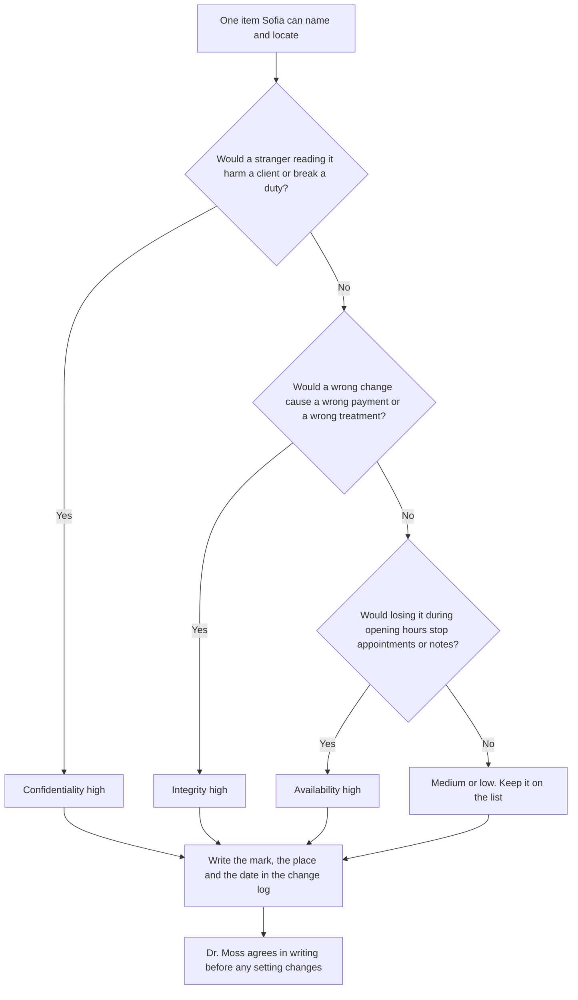
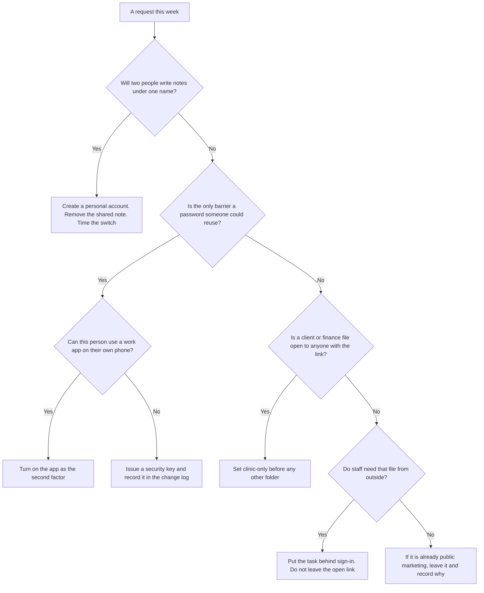
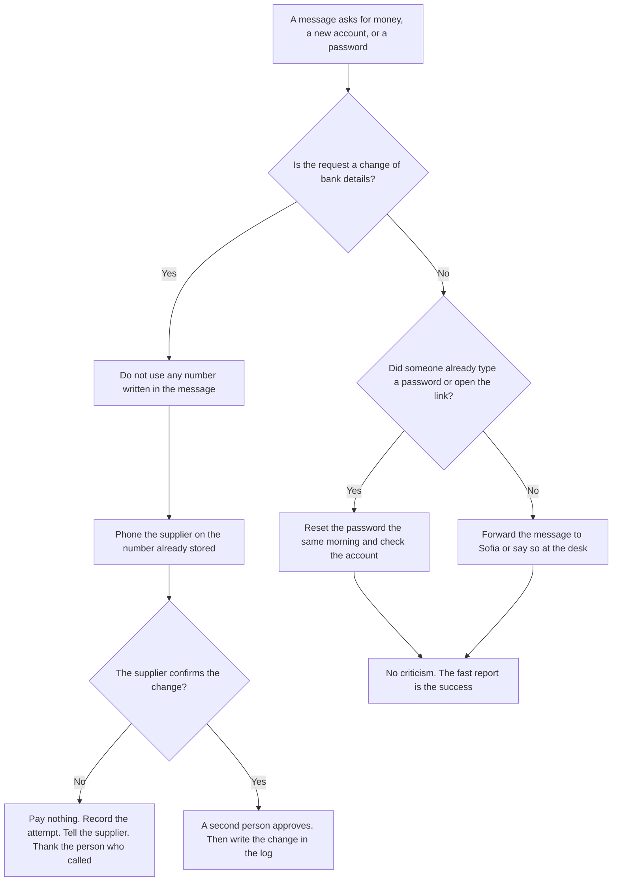
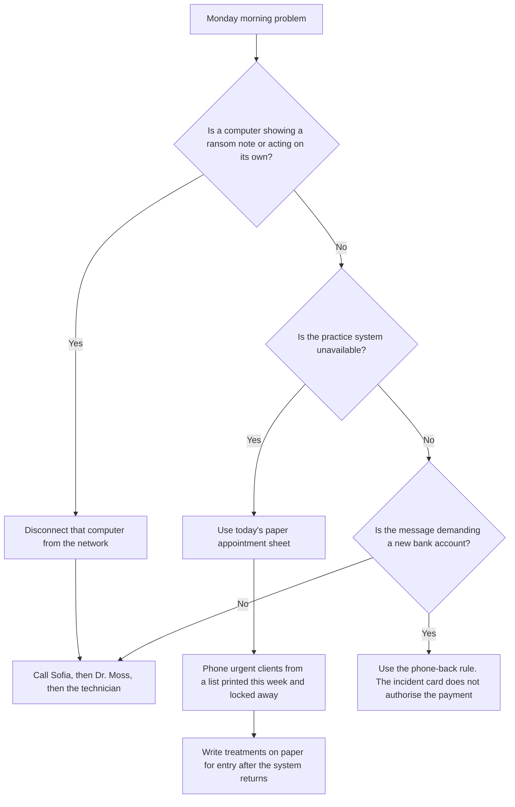

# Information Security: Rapid Course

- Language: English (`en`); course 002, Rapid course (1 month).
- Editorial state: **published**. Chapters 1–20 have hand-written teaching text; exercises EX001–EX074 have matching worked results with 0–3 rubrics; one offline lab uses only the Python 3 standard library on synthetic data, and their outputs are embedded from real runs. The rapid planning minimum is 20 lessons and there is no maximum. These twenty lessons meet that minimum. Independent review remains open. Page count is not the writing target. This is not a finished qualification.
- Audience: managers and staff of very small organisations who need to fix the most common security weaknesses in a month.
- Author: [hiagokinlevi](https://github.com/hiagokinlevi). Original text [CC0 1.0](../../../../../LICENSE); cited works keep their rights.
- Boundary: the lab counts synthetic shared files open to anyone with the link, by folder. Standards are cited by edition and paraphrased. All people, organisations, systems and data are **synthetic** unless a sentence cites a public source.

<!-- open-cyber-academy:chapter-lessons -->

[Course home](../../README.md) · [Chapter index](../SUBJECTS.md) · [Book plan](PLAN.md) · [Course skill](../../skill/SKILL.md) · [Worked results](#worked-results)

## How to use this book

Read in order. Twenty English chapter-lessons are published. Each numbered chapter is one authored lesson; the reader groups consecutive sets of five into four study weeks for pacing, without creating duplicate teaching pages. The first four follow Sofia Lindqvist from what the clinic holds, through accounts and sharing, and email fraud, to backups, the incident card and a monthly routine. Chapters 5–20 each settle one later question about that same month. Meeting the planning minimum does not close review. Run the lab where it appears, attempt each exercise before the worked results, and score yourself with the rubric. Chapters 1–4 also carry concept tables, data tables and exercises EX051–EX058.

### Synthetic running case

| Element | Role | Boundary |
|---|---|---|
| **Sofia Lindqvist** | Practice manager and learner | Invented |
| **Mr. Tomasz Nowak** | Trainer | Invented |
| **Eastgate Training Centre** | Fictional training centre | Invented |
| **Hollybank Veterinary Practice** | Fictional clinic, one site, eighteen staff | Invented |

### Core sources

ISO/IEC 27000:2026. Full list in [References](#references).

## Contents

| Chapters |
|---|
| [1](#ch-01) · [2](#ch-02) · [3](#ch-03) · [4](#ch-04) · [5](#ch-05) · [6](#ch-06) · [7](#ch-07) · [8](#ch-08) · [9](#ch-09) · [10](#ch-10) · [11](#ch-11) · [12](#ch-12) · [13](#ch-13) · [14](#ch-14) · [15](#ch-15) · [16](#ch-16) · [17](#ch-17) · [18](#ch-18) · [19](#ch-19) · [20](#ch-20) |

[Worked results](#worked-results) · [References](#references)

<a id="ch-01"></a>

## Chapter 1 — A month to get the basics right

### Learning outcomes

You will (1) describe what the one-month rapid course covers; (2) meet the running case; (3) list what a small practice holds and what it cannot lose.

### 1.1 The learner

Sofia Lindqvist is the practice manager at a small veterinary clinic. After a neighbouring business lost a week of work to ransomware, the owner asks her to make sure the clinic is not next. Sofia enrols on a one-month rapid course in information security at the fictional Eastgate Training Centre, with four weekly sessions and short tasks in between. Her trainer, Mr. Tomasz Nowak, has spent years helping small businesses recover from incidents. He tells the group that a month is enough to fix the most common weaknesses, though not to become an expert.

### 1.2 The practice

Sofia works at the fictional Hollybank Veterinary Practice, a single site with two vets, four nurses, three receptionists and a small office team, eighteen staff in all. The clinic uses a cloud practice management system for appointments, pet records and payments, a cloud email and file service, and nine computers plus two tablets. Client records hold names, addresses, phone numbers and payment history. An outside technician visits when something breaks. The owner, Dr. Rachel Moss, wants the clinic protected without slowing down the reception desk on busy mornings, when queues already build up.

### 1.3 What the clinic holds

In the first task, Sofia lists the information the clinic holds and where it lives. Pet and client records, appointments and payments are in the practice management system. Staff contracts and rotas are in shared folders. Supplier invoices and bank details arrive by email. Laboratory results come by email from an outside laboratory. Marketing photos for the clinic's social media pages are also in shared folders. Mr. Nowak asks her to mark each item by how much harm a leak, a wrong change or a loss would cause, using high, medium or low.

### 1.4 What cannot be lost

Sofia agrees three priorities with Dr. Moss. The clinic cannot lose access to the practice management system during opening hours, because appointments and treatment notes depend on it. It cannot let client contact and payment details leak, because clients trust the clinic with them and the law requires them to be protected. And it cannot pay a fraudulent supplier invoice, because margins are thin. Mr. Nowak explains that ISO/IEC 27000:2026 describes information security as protecting confidentiality, integrity and availability, and that Sofia's three priorities map neatly onto those three goals.

### 1.5 Ground rules

Mr. Nowak sets three rules for the month. Get Dr. Moss's written agreement before changing any setting. Never put real client details into coursework or shared examples. Write down each change with the date and the reason, so the technician and Dr. Moss can see what was done. Sofia creates a simple change log in a shared document only she and Dr. Moss can open. Mr. Nowak adds that small businesses are often harmed by well-meant changes that nobody recorded, because problems later cannot be traced back to their cause.

### Worked example

Sofia joins the rapid course, lists what Hollybank's eighteen-person clinic holds, agrees three priorities tied to confidentiality, integrity and availability, and starts a change log.

> **Synthetic case.** Eastgate, Hollybank and all people are synthetic.

### Errors and limits

Unrecorded changes make later problems hard to trace.

### Concepts — three goals, one harm mark

ISO/IEC 27000:2026 names confidentiality, integrity and availability. Sofia's high, medium or low mark is how Hollybank uses those goals before it buys any product. A mark is not a feeling about how secret a file sounds. It is the harm a stranger's reading, a wrong change, or a loss would cause on a real Monday.

| Goal | Question | Already high at Hollybank | Still listed when the mark is low |
|---|---|---|---|
| Confidentiality | Who is harmed if a stranger reads this? | Client contacts and payment history | A marketing photo already on the public page |
| Integrity | Which decision goes wrong if this is altered? | Supplier bank details on an invoice | A draft caption for a social post |
| Availability | What stops during opening hours if this is gone? | Practice system: appointments and treatment notes | Last year's poster file |

### Data — where Hollybank's information sits

| Information | Place | How it arrives | Harm |
|---|---|---|---|
| Pet records, appointments, payments | Cloud practice system | Typed at reception | High. The morning queue and the treatment notes stop together |
| Client name, address, phone, payment history | Same system | Reception | High confidentiality. Clients trusted the clinic, and the law requires protection |
| Staff contracts and rotas | Shared folders | Office | Contracts are sensitive. Rotas look ordinary and become a sharing problem in the next chapter |
| Supplier invoices and bank details | Email | The supplier | High integrity. A wrong account number moves money |
| Laboratory results | Email | Outside laboratory | High. A missing or altered result changes treatment |
| Marketing photos | Shared folders | Staff | Low only after the same image is already public |

Count the places, not the brand names. Six kinds of information sit in three places: the practice system, shared folders and email. The change log records a move between those places. It does not replace the mark.

### Decision flow — mark one item



An item can score high on more than one goal. The flow asks the three questions in order so a busy reception does not stop at the first word that sounds technical. The log line is the evidence that the mark was made. Without the date and the reason, a later problem cannot be traced, which is the ground rule in section 1.5.

### Worked example — a photograph that is not marketing

A nurse copies a wound photograph into the marketing folder so she can find it on the next shift. The filename begins with the client's first name. Sofia does not use the marketing row of the table. A stranger who opens that folder would see a clinical image tied to a client, so confidentiality is high. A missing file on the day of a recheck would also hide the comparison the vet needs, so availability is high for the working copy. Sofia moves the photograph into the practice system, deletes the shared copy, and writes the move in the change log before the end of the shift. Dr. Moss agrees in writing because staff will look in a new place tomorrow.

> **Synthetic case.** The photograph, the filename and the nurse's shortcut are invented. No animal or client is depicted.

### Apply

- **EX051 — Mark a laboratory result.** An email names the client. If the text is wrong, the afternoon treatment changes. If the email is missing that morning, the vet cannot compare it with the notes. Give the confidentiality mark, the integrity mark, and say which goal is threatened first by the missing email. *Rubric:* 3 = confidentiality high because the client is named; integrity high because treatment would be wrong; availability is first if the email is missing when the vet needs it;; 2 = two of those three;; 1 = one;; 0 = none.
- **EX052 — Late log.** Sofia moves the photograph on Monday and writes the change log on Friday. Which ground rule failed, and what can still be true on Wednesday? *Rubric:* 3 = each change is written with the date and the reason when it happens; on Wednesday the shared copy may still be open and nobody can trace the move;; 2 = the same-day log rule only;; 1 = vague;; 0 = none.

### Exercises

- **EX001 — Course length.** How long is Sofia's course? *Rubric:* 3 = one month, four sessions;; 2 = partly correct;; 1 = partial;; 0 = none.
- **EX002 — Trigger.** What prompted the owner to act? *Rubric:* 3 = a neighbour's ransomware;; 2 = partly correct;; 1 = vague;; 0 = none.
- **EX003 — Staff count.** How many staff does Hollybank have? *Rubric:* 3 = eighteen;; 2 = partly correct;; 1 = wrong;; 0 = none.
- **EX004 — Core system.** Where are pet records and appointments kept? *Rubric:* 3 = cloud practice management system;; 2 = partly correct;; 1 = other;; 0 = none.
- **EX005 — Device count.** How many computers and tablets does the clinic use? *Rubric:* 3 = nine computers, two tablets;; 2 = both;; 1 = one;; 0 = none.
- **EX006 — Owner's condition.** What did Dr. Moss ask for? *Rubric:* 3 = protection without slowing reception;; 2 = partly correct;; 1 = vague;; 0 = none.
- **EX007 — Lab results.** How do laboratory results arrive? *Rubric:* 3 = by email;; 2 = partly correct;; 1 = other;; 0 = none.
- **EX008 — Harm marking.** How does Sofia mark each information item? *Rubric:* 3 = high, medium or low harm;; 2 = partly correct;; 1 = vague;; 0 = none.
- **EX009 — Availability priority.** Which priority is about availability? *Rubric:* 3 = practice system during opening hours;; 2 = partly correct;; 1 = other;; 0 = none.
- **EX010 — Integrity priority.** Which priority is about integrity? *Rubric:* 3 = not paying a fraudulent invoice;; 2 = partly correct;; 1 = other;; 0 = none.
- **EX011 — Standard named.** Which standard describes the three goals? *Rubric:* 3 = ISO/IEC 27000:2026;; 2 = partly correct;; 1 = other;; 0 = none.
- **EX012 — Change log access.** Who can open the change log? *Rubric:* 3 = Sofia and Dr. Moss;; 2 = partly correct;; 1 = other;; 0 = none.
- **EX013 — Why log changes.** Why record each change? *Rubric:* 3 = so problems can be traced;; 2 = partly correct;; 1 = vague;; 0 = none.

<!-- open-cyber-academy:chapter-navigation:start ch-01 -->
### Continue studying — lesson 01 (chapter 01 of 20)

[← Course home](../../README.md) · [Course chapter index](../SUBJECTS.md) · [Chapter 02 →](#ch-02)

Continue to the next authored lesson.
<!-- open-cyber-academy:chapter-navigation:end -->

<a id="ch-02"></a>

## Chapter 2 — Accounts, devices and sharing

The arrows show a reading sequence, not a proof that a control succeeded. The maps cover the same nine section labels in both editions; the text drawing supplies the same sequence without requiring a rendered diagram.


### Learning outcomes

You will (1) distinguish a personal account and an additional authentication factor; (2) explain the clinic's device changes; (3) interpret a synthetic sharing count and plan authorized restrictions. The script neither discovers nor closes real file shares.

### 2.1 Own accounts

Sofia finds that reception staff share one login to the practice management system, written on a note under the keyboard. Mr. Nowak explains that shared logins hide who did what, and the note means anyone at the desk could sign in. The system supports personal accounts with quick switching between users, so Sofia sets up one account per person and removes the note. Reception staff worry about delays, so she times the switch during a busy morning and shows that it takes a few seconds. Dr. Moss approves the change after seeing the timing.

### 2.2 Second factor

Mr. Nowak explains that an additional, distinct authentication factor reduces reliance on the password alone; it is not a guarantee against account takeover. [NIST SP 800-63B-4](https://pages.nist.gov/800-63-4/sp800-63b.html) describes authentication as checking control of authenticators bound to an account. Its [phishing-resistance requirements](https://pages.nist.gov/800-63-4/sp800-63b/authenticators/#phishing-resistance) explain why manually entered codes are not phishing-resistant: an impostor can relay them. The case does not identify the apps' or keys' protocols, so their phishing resistance and authentication assurance level are not established here. Sofia turns on a second factor for email and the practice system, starting with Dr. Moss and the office team, who handle payments, then everyone else over two weeks. Two nurses do not want work apps on their own phones, so the clinic buys two small security keys for them. Sofia records each person's method in the change log so lost devices can be handled quickly.

### 2.3 Devices

Sofia checks the nine computers and two tablets with the technician. Three computers have updates switched off because an old label printer stopped working after an update last year. The technician installs a newer printer driver and switches updates back on. All devices now lock after five minutes, and staff accounts can no longer install software. The tablets used in consulting rooms get a passcode and remote wipe. Mr. Nowak notes that switching updates off to solve one problem is common, and that the fix is to solve the underlying problem instead of leaving devices exposed.

### Lab — Shared files open to anyone with the link, by folder, in a synthetic file store

**Execution boundary:** This complete program generates 300 artificial `(folder, open_flag)` rows in memory. It does not import the export mentioned in the story, read a cloud account, inspect effective permissions or change any sharing setting. The folder probabilities are invented generation parameters, not measured exposure rates. [Python's `random` documentation](https://docs.python.org/3.13/library/random.html) describes the generator used here; the fixed seed supports repeating this example, not estimating another organisation's files.

The labels `clients`, `finance`, `marketing` and `rotas` mean client files, finance files, marketing files and staff schedules. Keep these labels, the seed, input order and printed output unchanged when comparing editions. An empty input is missing data, not evidence of zero exposure. Duplicate rows would be counted again because the fixture has no unique file identifier. Restricting a real share remains a separate, authorized task; this run does not perform it.

```python
"""Find synthetic shared files open to anyone with the link, by folder (stdlib only)."""
import random
from collections import Counter
random.seed(2)
files = []
for folder, n, p in [("clients", 140, 0.04), ("finance", 60, 0.05), ("marketing", 80, 0.30), ("rotas", 20, 0.5)]:
    for i in range(n):
        files.append((folder, random.random() < p))
total = Counter(f for f, _ in files)
open_ = Counter(f for f, o in files if o)
for f in total:
    print(f"{f}: {open_[f]} of {total[f]} open to anyone with the link")
print(f"all files: {sum(open_.values())} of {len(files)}")
```

Run with `python3 lab_sharing.py`. Verified output:

```text
clients: 8 of 140 open to anyone with the link
finance: 4 of 60 open to anyone with the link
marketing: 25 of 80 open to anyone with the link
rotas: 10 of 20 open to anyone with the link
all files: 47 of 300
```

### 2.4 Over-shared files

With Dr. Moss's permission, the technician exports a list of shared files and whether each is open to anyone with the link. Sofia runs the script on a synthetic copy with the same folder structure. It finds 47 of 300 files open to anyone with the link. Most are marketing photos, 25 of 80, and staff rotas, 10 of 20. But 8 of 140 files in the client folder and 4 of 60 in the finance folder are also open. Those twelve matter most, because anyone who obtains a link could read client or bank information.

### 2.5 Closing the gaps

Sofia changes the twelve client and finance files to clinic-only sharing first. She then asks staff why rotas were shared openly and learns that part-time staff check them from home on personal phones. She moves the rota to the practice system, where staff can see it after signing in. Marketing photos can stay public because they are already posted online. Sofia asks the technician to set the default for new shares to clinic-only, and adds a monthly reminder to rerun the check. Mr. Nowak praises her for fixing the reason behind the rota sharing, not just the setting.

### Worked example

Sofia replaces a shared reception login, turns on second factors with security keys for two nurses, re-enables updates on three computers and finds 47 of 300 synthetic files open to anyone, including 12 client and finance files.

> **Synthetic case.** Accounts, devices and files are synthetic.

### Errors and limits

Switching off updates to fix a printer leaves devices exposed long after the printer is forgotten.

### Concepts — identity, possession, and exposure

Three different controls are easy to mix up because all three are "turned on" in the same week.

| Control | What the evidence can support | Hollybank failure it addresses | What it does not establish |
|---|---|---|---|
| Personal account | The account or session under which activity is recorded, if the relevant records are available | One reception login on a note under the keyboard | Which physical person acted, whether credentials or a session were compromised, or whether the action was authorized |
| Second factor | Successful use of the factors required by the configured authentication procedure | Reliance on a password alone | That every MFA method resists phishing or that access to a particular file is authorized |
| Clinic-only share | An intended restriction to the clinic's authorized accounts, subject to checking effective permissions | 8 client files and 4 finance files open to anyone with the link | A restriction to the clinic building, or that every legitimate workflow still succeeds |

Here, **clinic-only** describes authorization, not physical location: the next paragraph still allows authorized staff to view the rota from home after signing in. Account attribution is not conclusive identification of a human actor. The NIST reference above explains authentication evidence; this table applies that distinction to the synthetic case and does not assign the clinic an assurance level or certify compliance. Preserve the original written-approval rule before any real setting change; the narrative's ordering is not permission to approve a change retroactively.

The rota shows the third limit. Closing a link without replacing the work makes part-time staff invent a new workaround. Sofia moved the rota into the practice system, behind sign-in, because the home check was a real task.

### Data — the synthetic share count, ranked by harm

The verified script, seed 2, printed these counts. Rank follows harm, not the size of the number.

| Folder | Open | Of | Rank | Why this rank | Action in the chapter |
|---|---:|---:|---|---|---|
| Clients | 8 | 140 | 1 | A link exposes client information | Clinic-only the same day |
| Finance | 4 | 60 | 1 | A link exposes bank information | Clinic-only the same day |
| Rotas | 10 | 20 | 2 | Half the folder is open, and the reason is home access | Move the rota behind sign-in |
| Marketing | 25 | 80 | 3 | Largest open count, images already public | Leave public |
| All files | 47 | 300 | — | The total is a check, not an order of work | Rerun monthly |

Twelve is 8 plus 4. Those twelve outrank the 25 marketing files. A monthly rerun catches a new share that used the old default.

### Decision flow — a person, a device, or a link



Updates sit beside this flow. Three computers had updates off because a label printer broke. The repair is a newer driver, then updates on. Leaving updates off keeps every other flaw on those machines after the printer is forgotten.

### Worked example — a locum who starts on Monday

A locum vet covers Monday and is told to use the reception login "only for this week". Sofia refuses. Notes written that day would be attributed to the shared desk, which is the defect in section 2.1. She creates a personal account before the first patient, turns on a second factor, and asks Dr. Moss to approve the account in the change log. She does not wait to time the switch: the reception timing already showed a few seconds, and a week of shared notes would outlast the locum. When the locum leaves, the same log says which account to disable.

> **Synthetic case.** The locum and the one-week instruction are invented.

### Apply

- **EX053 — Locum account.** What must exist before the locum's first patient, and which record says when to disable it? *Rubric:* 3 = a personal account with a second factor, approved in the change log; the same log names the account to disable when the locum leaves;; 2 = the personal account only;; 1 = vague;; 0 = none.
- **EX054 — Order the open files.** Using the verified counts, which 12 files are closed first, which folder is moved behind sign-in, and which open files may stay? *Rubric:* 3 = 8 client and 4 finance first; rotas move behind sign-in; marketing may stay because it is already public;; 2 = the twelve and one other action;; 1 = a count without the action;; 0 = none.

### Exercises

- **EX014 — Shared login.** What did reception use to sign in? *Rubric:* 3 = one shared login on a note;; 2 = partly correct;; 1 = partial;; 0 = none.
- **EX015 — Switch time.** How long does switching users take? *Rubric:* 3 = a few seconds;; 2 = partly correct;; 1 = vague;; 0 = none.
- **EX016 — First MFA group.** Who got a second factor first? *Rubric:* 3 = Dr. Moss and the office team;; 2 = partly correct;; 1 = partial;; 0 = none.
- **EX017 — Security keys.** Why were security keys bought? *Rubric:* 3 = two nurses declined apps on personal phones;; 2 = partly correct;; 1 = vague;; 0 = none.
- **EX018 — Updates off.** Why were updates off on three computers? *Rubric:* 3 = an old label printer broke after an update;; 2 = partly correct;; 1 = vague;; 0 = none.
- **EX019 — Update fix.** How was the printer problem fixed? *Rubric:* 3 = a newer printer driver;; 2 = partly correct;; 1 = other;; 0 = none.
- **EX020 — Tablet controls.** What did the consulting room tablets get? *Rubric:* 3 = passcode and remote wipe;; 2 = both;; 1 = one;; 0 = none.
- **EX021 — Open total.** How many files were open to anyone with the link? *Rubric:* 3 = 47 of 300;; 2 = partly correct;; 1 = wrong;; 0 = none.
- **EX022 — Marketing count.** How many marketing files were open? *Rubric:* 3 = 25 of 80;; 2 = partly correct;; 1 = wrong;; 0 = none.
- **EX023 — Sensitive open.** How many client and finance files were open? *Rubric:* 3 = 12 (8 client, 4 finance);; 2 = partly correct;; 1 = partial;; 0 = none.
- **EX024 — Rota cause.** Why were rotas shared openly? *Rubric:* 3 = part-time staff checked them from home;; 2 = partly correct;; 1 = vague;; 0 = none.
- **EX025 — Rota fix.** Where did the rota move? *Rubric:* 3 = into the practice system;; 2 = partly correct;; 1 = other;; 0 = none.
- **EX026 — Default setting.** What default did the technician set? *Rubric:* 3 = clinic-only sharing for new shares;; 2 = partly correct;; 1 = other;; 0 = none.

<!-- open-cyber-academy:chapter-navigation:start ch-02 -->
### Continue studying — lesson 02 (chapter 02 of 20)

[← Chapter 01](#ch-01) · [Course chapter index](../SUBJECTS.md) · [Chapter 03 →](#ch-03)

Continue to the next authored lesson.
<!-- open-cyber-academy:chapter-navigation:end -->

<a id="ch-03"></a>

## Chapter 3 — Email, fraud and people

### Learning outcomes

You will (1) recognise phishing and invoice fraud; (2) set a payment verification rule; (3) build a short, blame-free reporting habit.

### 3.1 Phishing signs

Mr. Nowak shows the group common signs of phishing: a sender address that does not match the name shown, unexpected urgency, a link whose real destination differs from its text, and requests for passwords or payments. Sofia picks three recent emails from the clinic's inbox that staff had asked about and checks them with the reception team. One claimed to be from a parcel company and linked to a lookalike address. Mr. Nowak stresses that no list catches everything, so the habit of pausing and checking matters more than memorising signs.

### 3.2 Invoice fraud

Small businesses are often targeted with messages that claim a supplier has changed bank details. Hollybank pays a drug wholesaler, a laboratory and several equipment suppliers. Sofia agrees a rule with Dr. Moss: any request to change bank details is checked by phoning the supplier on a number already held, never one in the message, and a second person approves the change. Mr. Nowak explains that this one rule stops most invoice fraud, whatever the email looks like, because the criminal cannot answer the phone at the real supplier's office.

### 3.3 The rule in action

Two weeks later, the office receives an email apparently from the equipment supplier, with a correct invoice number and a request to pay into a new account before the end of the day. The office assistant follows the rule and phones the supplier on the number in the clinic's records. The supplier has sent no such message and says its own mailbox may have been compromised. The clinic pays nothing to the new account. Sofia records the attempt, forwards the email to the supplier and thanks the assistant in front of the team.

### 3.4 Short training

Sofia runs a ten-minute session at the weekly staff meeting, using two synthetic examples that look like clinic emails, one about a parcel and one about a pet insurance claim. Staff find the signs together and agree what to do. Mr. Nowak advises against long annual training for a clinic this size; short, regular, relevant sessions are remembered better. Sofia plans one short topic a month, chosen from questions staff have asked, and keeps a list of the topics covered so new staff can catch up during their first week.

### 3.5 Reporting without blame

Sofia sets up one way to report anything suspicious: forward it to her or tell her at the desk. Dr. Moss tells staff that nobody will be criticised for clicking a link or making a mistake, as long as they report it quickly, because early reports make problems smaller. Within a week, a receptionist reports that she typed her password into a page that looked odd. Sofia resets the password the same morning and checks the account, finding no misuse. Mr. Nowak notes that the second factor would also have blocked a sign-in with that password.

### Worked example

Sofia teaches phishing signs, sets a phone-back rule that stops a synthetic invoice fraud attempt, runs ten-minute monthly sessions and gets a quick blame-free report of a typed password.

> **Synthetic case.** Emails and suppliers are synthetic.

### Errors and limits

Calling the number in a suspicious message reaches the criminal, not the supplier.

### Concepts — sign, channel, and report

A suspicious email is not one trick. Hollybank separates what the message looks like, which channel is allowed to change money, and how a person reports a mistake.

| Layer | What Sofia teaches | The clinic's concrete rule | The failure the rule blocks |
|---|---|---|---|
| Signs | Mismatched sender, unexpected urgency, a link whose destination differs from its text, a request for a password or a payment | Pause and check. No list is complete | The parcel message that linked to a lookalike address |
| Channel | Bank-detail changes | Phone a number already on file, never the number in the message. A second person approves | The equipment-supplier message with a real invoice number and a same-day demand |
| Report | One route, no blame for a fast report | Forward to Sofia or say so at the desk | The receptionist who typed a password into an odd page |

The phone-back rule does not depend on how convincing the writing is. The criminal can copy an invoice number. The criminal cannot answer the telephone at the real supplier. Calling the number printed in the message defeats the rule, because that telephone belongs to the sender of the fraud.

### Data — one attempted payment and the training rhythm

| Fact | Value in this case | Use |
|---|---|---|
| Suppliers paid by the clinic | Drug wholesaler, laboratory, equipment suppliers | Any of them can be impersonated |
| Message that arrived | Equipment supplier, correct invoice number, new account, pay today | Looks legitimate and is still unverified |
| Money sent to the new account | Nothing | The known-number call came first |
| Staff session | 10 minutes, weekly meeting, then one topic a month | Topics come from questions staff asked |
| Password typed into an odd page | Reset the same morning. Account checked. No misuse found | Speed matters more than a perfect sign list |
| Second factor | Would also block a later sign-in with that password | Reporting does not replace the factor from chapter 2 |

### Decision flow — a message asks for money or a secret



### Worked example — the laboratory changes its account on a Tuesday

On Tuesday an email quotes a real laboratory invoice and says the laboratory's bank account changes today. The office assistant almost calls the mobile number in the signature. Sofia stops that call. The stored number is the laboratory's accounts desk from last month's statement. The desk says it sent no change. The clinic pays the original account and nothing to the new one. A second person had been ready to approve, and does not approve. Sofia writes the attempt in the change log and thanks the assistant at the next ten-minute session, using the episode as the month's topic.

> **Synthetic case.** The Tuesday message and the laboratory desk are invented. The rule is the same rule as the equipment-supplier episode.

### Apply

- **EX055 — Tuesday call.** Which number may be used, what the second person may approve, and how much is paid before the stored-number call? *Rubric:* 3 = only the number already stored; the second person approves nothing until that call confirms the change; nothing is paid before the call;; 2 = the stored number and the zero payment;; 1 = one of those;; 0 = none.
- **EX056 — Typed password, same morning.** List the three actions that follow a quick report of a typed password, and what Dr. Moss has promised. *Rubric:* 3 = reset that morning, check the account, remember the second factor would block a later sign-in; no criticism because the report was quick;; 2 = reset and check, without the promise;; 1 = one action;; 0 = none.

### Exercises

- **EX027 — Four signs.** Name two phishing signs. *Rubric:* 3 = mismatched sender, urgency, odd link, password or payment request;; 2 = two;; 1 = one;; 0 = none.
- **EX028 — Parcel email.** What did the parcel email link to? *Rubric:* 3 = a lookalike address;; 2 = partly correct;; 1 = other;; 0 = none.
- **EX029 — Key habit.** What matters more than memorising signs? *Rubric:* 3 = pausing and checking;; 2 = partly correct;; 1 = vague;; 0 = none.
- **EX030 — Bank rule.** What is the bank detail change rule? *Rubric:* 3 = phone a known number, second approval;; 2 = both;; 1 = one;; 0 = none.
- **EX031 — Why it works.** Why does the phone-back rule stop fraud? *Rubric:* 3 = the criminal cannot answer the real supplier's phone;; 2 = partly correct;; 1 = vague;; 0 = none.
- **EX032 — Fake invoice.** Which supplier did the fake email impersonate? *Rubric:* 3 = the equipment supplier;; 2 = partly correct;; 1 = other;; 0 = none.
- **EX033 — Outcome.** How much did the clinic pay to the new account? *Rubric:* 3 = nothing; the request was refused after the call;; 2 = nothing, without saying why;; 1 = wrong;; 0 = no answer.
- **EX034 — Training length.** How long is each staff session? *Rubric:* 3 = ten minutes;; 2 = partly correct;; 1 = wrong;; 0 = none.
- **EX035 — Topic source.** How are monthly topics chosen? *Rubric:* 3 = from staff questions;; 2 = partly correct;; 1 = other;; 0 = none.
- **EX036 — Report route.** How do staff report something suspicious? *Rubric:* 3 = forward to Sofia or tell her;; 2 = partly correct;; 1 = partial;; 0 = none.
- **EX037 — Owner's promise.** What did Dr. Moss promise staff? *Rubric:* 3 = no criticism for quick reports;; 2 = partly correct;; 1 = vague;; 0 = none.
- **EX038 — Typed password.** What did Sofia do about the typed password? *Rubric:* 3 = reset it and checked the account;; 2 = both;; 1 = one;; 0 = none.

<!-- open-cyber-academy:chapter-navigation:start ch-03 -->
### Continue studying — lesson 03 (chapter 03 of 20)

[← Chapter 02](#ch-02) · [Course chapter index](../SUBJECTS.md) · [Chapter 04 →](#ch-04)

Continue to the next authored lesson.
<!-- open-cyber-academy:chapter-navigation:end -->

<a id="ch-04"></a>

## Chapter 4 — Backups, incidents and the plan ahead

### Learning outcomes

You will (1) confirm the clinic can restore its data; (2) write a one-page incident card; (3) set a simple plan for the months after the course.

### 4.1 Backups

Sofia asks the practice system provider how its data is backed up and how quickly it could be restored. The provider keeps daily backups for thirty days and can restore within a day. The clinic's email and shared files have no separate backup, so a deletion noticed late would be lost. Dr. Moss approves a low-cost backup service for email and files. Mr. Nowak explains that a provider keeping its service running does not mean your own deleted or encrypted files can be recovered, which surprises several people in the group.

### 4.2 Testing a restore

Sofia asks the technician to restore one folder and one mailbox from the new backup into a test area. The folder restores in minutes. The mailbox restore fails on the first attempt because the backup had not finished its first full copy. On the second attempt a week later it works. Sofia records both results in the change log. Mr. Nowak praises her for testing, because many businesses discover backup problems only when they need the backup, at the worst possible moment, and with clients waiting at the desk.

### 4.3 An incident card

Sofia writes a one-page incident card and pins it in the office. It lists what counts as an incident, such as a lost tablet, a suspicious sign-in alert, a ransom message or client details sent to the wrong person; who to call first, which is Sofia, then Dr. Moss, then the technician; the first steps, such as disconnecting an affected computer from the network; and the phone numbers of the practice system provider and the data protection adviser. She also keeps a paper appointment sheet for the day in case the system is unavailable.

### 4.4 A practice drill

Sofia runs a twenty-minute drill with Dr. Moss and two receptionists. The scenario: on a Monday morning, the practice system is unavailable for four hours. The team uses the paper sheet, phones clients with urgent appointments from a printed list and records treatments on paper for entry later. They discover the printed list is three weeks old and missing new clients. Sofia sets a weekly reminder to print a fresh list and lock it in the office. Mr. Nowak notes that drills find small gaps that are easy to fix beforehand and painful to discover during a real outage.

### 4.5 The plan ahead

At the last session, Sofia lists what changed in the month: personal accounts and second factors for everyone, updates back on, twelve sensitive files no longer open to anyone, a phone-back rule that stopped one fraud attempt, a tested backup and an incident card. She sets a short monthly routine: rerun the sharing check, review leavers' accounts, give one ten-minute session and test one restore. Mr. Nowak recommends the data governance rapid course next, since the clinic's retention of old client records is the next question Dr. Moss wants answered.

### Worked example

Sofia adds a backup for email and files, tests a restore that fails once then succeeds, pins a one-page incident card, finds a stale client list in a drill and sets a four-item monthly routine.

> **Synthetic case.** Providers, times and drills are synthetic.

### Errors and limits

Assuming a cloud provider will recover your deleted or encrypted files can leave the business with no copy.

### Concepts — a copy, a test, a card, a drill

A backup that has never been restored is a claim. Hollybank separates four artefacts. Each one answers a different question, and none of them replaces the others.

| Artefact | Question it answers | What Hollybank learned | What would still be missing |
|---|---|---|---|
| Provider retention | How far back can the practice system go? | Daily copies, kept 30 days, restore quoted within a day | The clinic's email and shared files were not in that promise |
| Separate backup | Who holds a copy of email and files? | Dr. Moss approved one after the gap was named | An untested job can still be empty |
| Restore test | Can a named folder and a named mailbox return? | The folder returned in minutes. The mailbox failed until the first full copy finished, then worked a week later | A test does not restore the whole clinic |
| Incident card and drill | What do people do in the first hour, and does the fallback work? | Call Sofia, then Dr. Moss, then the technician. Disconnect an affected computer. The paper list was three weeks old | A card nobody has rehearsed |

The provider keeping its own service running is not a copy of a file the clinic deleted or that an attacker encrypted. That distinction is why the email backup exists.

### Data — restore evidence and the Monday fallback

| Check | Result | Where it is written |
|---|---|---|
| Practice-system retention | 30 days, daily | Sofia's note from the provider |
| Email and shared files before the new service | No separate backup | The gap Dr. Moss approved spending to close |
| Folder restore | Minutes, into a test area | Change log |
| First mailbox restore | Failed. The first full copy had not finished | Change log, including the failure |
| Second mailbox restore | Worked a week later | Change log |
| Drill | 20 minutes. System treated as down for four hours | Paper notes entered later |
| Printed client list | Three weeks old, missing new clients | Weekly reminder: print a fresh list and lock it away |
| Monthly routine | Sharing check, leavers' accounts, one ten-minute session, one restore test | Set at the last session |

Both restore results stay in the log. Recording only the success would hide the week in which the mailbox copy did not exist.

### Decision flow — the practice system is down, or a screen asks for money



The card and the payment rule stay in force together. A frightening screen is not a reason to pay the account number printed on that screen.

### Worked example — a full copy that is not a finished backup

The new backup service shows a green dashboard glyph on Thursday. Sofia does not record the backup as tested. The glyph appeared before the first full copy of the mailbox finished, which is the same condition that made the first restore fail. She asks the technician to restore one mailbox into the test area and waits for that result. The restore fails. She writes the failure, leaves the glyph out of the monthly routine, and schedules the second attempt for the following week. Only the second, successful restore of that named mailbox goes into the change log as a passed test.

> **Synthetic case.** The green dashboard glyph, the mailbox nickname and the seven-day wait are invented. The failure condition matches the restore already recorded in section 4.2.

### Apply

- **EX057 — Whose copy is it?** The practice-system provider keeps 30 days of daily backups. A receptionist deletes a shared-folder file that was never in the practice system. Which copy brings it back, and which promise does not? *Rubric:* 3 = only the separate email-and-files backup, after a restore of that folder has succeeded; the provider's 30 days never held this file;; 2 = the separate backup without the test;; 1 = the provider;; 0 = none.
- **EX058 — Ransom screen at reception.** State the first technical step, the call order, and whether the account number on the screen may be paid. *Rubric:* 3 = disconnect that computer; call Sofia, then Dr. Moss, then the technician; pay nothing from the screen, the phone-back rule still applies;; 2 = disconnect and the call order;; 1 = one of those;; 0 = none.

### Exercises

- **EX039 — Provider backups.** How long does the practice system provider keep backups? *Rubric:* 3 = thirty days;; 2 = partly correct;; 1 = wrong;; 0 = none.
- **EX040 — Missing backup.** What had no separate backup? *Rubric:* 3 = email and shared files;; 2 = both;; 1 = one;; 0 = none.
- **EX041 — First failure.** Why did the first mailbox restore fail? *Rubric:* 3 = first full copy not finished;; 2 = partly correct;; 1 = vague;; 0 = none.
- **EX042 — First call.** Who is called first in an incident? *Rubric:* 3 = Sofia;; 2 = partly correct;; 1 = other;; 0 = none.
- **EX043 — First step.** What is a first step for an affected computer? *Rubric:* 3 = disconnect it from the network;; 2 = partly correct;; 1 = other;; 0 = none.
- **EX044 — Paper fallback.** What paper fallback does Sofia keep? *Rubric:* 3 = the day's appointment sheet;; 2 = partly correct;; 1 = other;; 0 = none.
- **EX045 — Drill length.** How long was the drill? *Rubric:* 3 = twenty minutes;; 2 = partly correct;; 1 = wrong;; 0 = none.
- **EX046 — Drill gap.** What gap did the drill find? *Rubric:* 3 = printed client list was three weeks old;; 2 = partly correct;; 1 = vague;; 0 = none.
- **EX047 — Gap fix.** How was the drill gap fixed? *Rubric:* 3 = weekly fresh printout, locked away;; 2 = partly correct;; 1 = partial;; 0 = none.
- **EX048 — Sensitive files.** How many sensitive files were closed off? *Rubric:* 3 = twelve;; 2 = partly correct;; 1 = wrong;; 0 = none.
- **EX049 — Monthly routine.** Name two items in the monthly routine. *Rubric:* 3 = sharing check, leavers, session, restore test;; 2 = two;; 1 = one;; 0 = none.
- **EX050 — Next step.** What course comes next and why? *Rubric:* 3 = data governance rapid, retention of old records;; 2 = both;; 1 = one;; 0 = none.

<!-- open-cyber-academy:chapter-navigation:start ch-04 -->
### Continue studying — lesson 04 (chapter 04 of 20)

[← Chapter 03](#ch-03) · [Course chapter index](../SUBJECTS.md) · [Chapter 05 →](#ch-05)

Continue to the next authored lesson.
<!-- open-cyber-academy:chapter-navigation:end -->

<a id="ch-05"></a>

## Chapter 5 — A reminder is not a fresh list

### Learning outcomes

After this chapter, you should be able to:

1. Tell a calendar reminder apart from the paper it is meant to produce.
2. Refuse urgent calls from the three-week list while that list is still the one in the drawer.
3. Record a caller the old list omits, instead of saying the clinic has no record.

### 5.1 The drawer still holds the old page

Chapter 4 ended with a decision to print a fresh list each week and lock it away. The change log, as written in that chapter, records the reminder. It does not record a later print. Reception still has the list the drill used. New clients who registered after that print are missing from it. Phoning only the names on that page repeats the gap the drill found.

Staff who cannot find a caller on the page do not announce that the clinic has no such client. The page is an old extract. They write the caller's name, the time, and "confirm when the practice system returns," on the day's appointment sheet. They do not invent an appointment to be helpful.

### 5.2 Worked example

| What someone points to | What it proves | Decision |
|---|---|---|
| "The reminder is in the calendar." | Sofia intends a weekly print | Not a list |
| "The list in the drawer has names." | Those names were current three weeks ago | Do not treat it as this week |
| "A caller is missing, so they are new and unregistered." | The old page cannot show later registrations | Write the call down for confirmation |
| "Reprint from memory before the system returns." | Memory is not the practice system | Refuse |

> **Synthetic case.** No new print is added by this lesson. The three-week age is the drill's finding, not a new measurement.


### 5.3 A planned control and an operating control are not the same evidence

A **reminder** is a scheduled instruction to perform a future action. A **fresh printout** is a specific copy of information from a stated source at a stated time. A **verified usable list**, for this training question, would additionally need the clinic's approved handling conditions to be met: a visible print date, a corresponding recorded print in the authorized change log, appropriate protection in the locked location, and a check that the list's cutoff is suitable for the intended urgent-call decision. A reminder may support the intention to print every week; it cannot supply the resulting page, its contents or the time at which it was created.

The Hollybank drill already found a three-week-old printed client list and missing newer registrations. Sofia then **set a weekly reminder** to print and lock a fresh copy. These are two different facts in the fictional case. No later print, dated sheet, new log line or comparison with the live practice system was released in Chapter 5. An auditor should therefore record **control planned**, not **fresh fallback demonstrated**. A box ticked in a calendar can describe scheduling, not successful execution.

The [NIST Cybersecurity Framework 2.0](https://doi.org/10.6028/NIST.CSWP.29) identifies **PR.DS-01** for protecting the confidentiality, integrity and availability of stored information and **PR.IR** for the resilience of technology infrastructure. Those are organizational outcomes, not rules that declare a Hollybank paper list current. The distinctions in this chapter are original classroom reasoning from those concepts. No actual clinic system, printer or client list was accessed.

### 5.4 Model the age, source and completeness of a paper extract

Treat the list as a **snapshot**: an extract of information at the time and with the coverage the source supplied. The case says the drill's paper was three weeks old; it does not supply a newly timed print. Even a correctly printed list will not automatically include registrations made *after* its cutoff. A name missing from a subset is therefore **not evidence that no client record exists** in the practice system.

| Item in the fictional file | What it establishes | What it cannot establish |
|---|---|---|
| Calendar reminder for weekly printing | Sofia scheduled a recurring task | Anyone actually printed, checked or locked a new list |
| The old list in the drawer | A paper population that was already three weeks old during the drill | Complete coverage of later registrations or this week's urgent-call population |
| A caller absent from that old list | No matching name on that particular historic extract | The caller is new, unknown to the practice, unregistered, not booked or eligible for any clinical action |
| Today's appointment paper | A limited place to record and review today's desk interactions and appointments | A rebuilt client register, a current urgent-call population or a confirmed new appointment |
| A later authenticated practice-system result | **Not supplied in this chapter** | No restoration, refreshed list, identity match or booking confirmation may be declared |

There are **two time questions**: *when was the sheet printed?* and *what time span and records does it cover?* Those might differ even when a page looks recent. A print date alone does not prove that a complete data refresh occurred; in a real process the source owner would define the intended cutoff and validation checks. Hollybank's current teaching fixture contains **no such successful later validation**. The known old list is not silently replaced by a hypothetical better one.

For confidentiality, the printed names still need the exercise's locked-away handling. The staff member should not copy that list into a personal device or public message just to fill the gap. For integrity, a memory-based recreation cannot claim to be a source printout. For availability, the desk needs a useful fallback, but calling old data “available” does not make it up to date.

### 5.5 Worked contrast: the caller whose name is missing

In the tabletop a caller supplies a name not on the old client list. The worker must answer the **question that the paper can actually support**: the name is not on *this extract*. The worker cannot infer that Hollybank has no record. They also cannot promise a clinical appointment, prescribe urgency or decide what treatment should occur from the list's absence.

A permitted **offline record** under the existing exercise rule is a line on **today's appointment sheet** with the caller's supplied name, the time of the call, and an explicit state such as **“confirm when the practice system returns.”** The line documents *a contact received and a question unresolved*. It does not create a registration, appointment, treatment, patient file, or verified identity match. No name or time value is added by this teaching example: the learner uses the scenario's supplied caller details only.

| Proposed response | Evidence behind it | Decision in the classroom |
|---|---|---|
| “The reminder fired; this list is fresh.” | Only the scheduling commitment is in the change log | Refuse the freshness assertion |
| “Your name is not on this old page, so the clinic has no record of you.” | The page predates possible later registrations | Refuse the absence-to-nonexistence inference |
| “I will put you down as confirmed at the next opening.” | No current booking result or authority is provided | Do not invent an appointment |
| “I will record the call and mark it for checking in the practice system when that source becomes available.” | Today's paper fallback is allowed for a bounded desk record | Accept as **pending verification**, not completed confirmation |
| “Rebuild the urgent-call list from staff recollections.” | No source validation or owner approval | Refuse the substitute population |

**Example note for review, not a new case observation:** “Contact received; supplied name and call time noted on today's appointment sheet; not found on the known old list; practice-system identity/appointment status **unverified**; follow-up check needed when the authorized source is available.” This is a template, not a claim that any real named client has been called.

### 5.6 Safe follow-up: check later without backdating the result

Once an authorized source becomes available, a designated worker would need to compare the pending contact with the practice system using the approved identity and booking workflow, resolve any mismatch or duplicate entry under the clinic's actual rules, and separately record the verified outcome. The course supplies **no evidence that this later action occurred**, so the result stays pending. The old list is retained as evidence of what was available during the drill, not edited to look newer.

A useful verification ledger separates three fields: **source/time** (the three-week-old paper), **pending question** (whether a caller is represented in the relevant system records), and **later disposition** (empty until an authorized check actually occurs). This guards against backdating a later answer into the outage window. A page absent of a name does not prove the person absent from the system, and a newly printed page—if it existed—would still be a time-bounded snapshot rather than omniscient evidence.

The [NIST SP 800-61 Rev. 3](https://csrc.nist.gov/pubs/sp/800/61/r3/final) treats preparation, response and recovery as coordinated risk-management activities. It does **not** specify Hollybank's reception workflow or establish an incident from this synthetic outdated-list exercise. This chapter adapts the general value of documented assumptions, checkpoints and verifiable follow-up without asserting medical or legal requirements.

### 5.7 Negative controls and independent practice

**Negative control A: the calendar becomes perfectly reliable.** Imagine every reminder notification appears on time. That still does not show that any page was printed, reviewed, dated or locked; the source gap remains. The relevant observable outcome would be a separately evidenced print and applicable source check, not the reminder itself.

**Negative control B: the printed list contains many valid names.** That does not establish its coverage of registrations after its old snapshot. A known name might be present while the missing caller still requires an authorized system check. A valid positive match and an unproven negative claim are not symmetrical.

**Negative control C: someone remembers the caller.** Memory may suggest a question for later comparison but is not a substitute current list, a verified patient record or authority to book an appointment. Neither the worker nor this book makes a clinical judgment.

**Negative control D: a new print is promised.** A promise is a future action, not a received result. Do not move the evidence cutoff forward, claim the system returned, or mark the pending contact resolved before source verification.

**Independent EX059 practice:** First answer the original prompt in three parts: **which paper and calendar artifacts exist**, **which claim you refuse**, and **what exactly is recorded for later checking**. Then create a four-column table headed *source/time*, *claim*, *evidence gap* and *safe next action*. Evaluate the reminder, the old list, the absent caller and the hypothetical later check separately. Explain why today's appointment paper is a **pending-contact record** rather than a confirmed registration or a replacement urgent-call list. Compare your answer with [the EX059 worked result](#answer-ex059); do not invent a date, new page, client identity or medical advice.

### Errors and limits

This lesson does not say a fresh list would be useless. It says the fresh list is not in evidence yet. When a dated print is locked, urgent calls may use that print, and only for the names it shows. Clients absent from even a fresh list are still confirmed against the system when it returns. The data-governance course remains the next course for how long old client records are kept. This chapter does not answer retention.

### Apply

- **EX059 — Reminder versus paper.** The calendar reminder exists. The drawer still holds the drill's list. A caller gives a name that is not on it. What do you use, what do you refuse to say, and what do you write? *Rubric:* 3 = do not use the old list as this week's list; do not say the clinic has no record; write the call for confirmation when the system returns;; 2 = refuse the old list and the "no record" sentence;; 1 = one of those;; 0 = none.

  - **Independent extension:** Distinguish (a) the calendar reminder, (b) the three-week-old paper, (c) the absent name on that paper, and (d) a later practice-system verification **not yet performed**. For each, write a source/time, supported claim, missing evidence and next step.
  - **Negative controls:** Do not call the old extract “this week's list,” treat absence as nonregistration, invent a new print or appointment, or claim the practice system has already confirmed the caller.
  - **Worked answer:** [EX059](#answer-ex059).

<!-- open-cyber-academy:chapter-navigation:start ch-05 -->
### Continue studying — lesson 05 (chapter 05 of 20)

[← Chapter 04](#ch-04) · [Course chapter index](../SUBJECTS.md) · [Chapter 06 →](#ch-06)

Continue to the next authored lesson.
<!-- open-cyber-academy:chapter-navigation:end -->

<a id="ch-06"></a>

## Chapter 6 — The outage paper is the record of those hours

### Learning outcomes

After this chapter, you should be able to:

1. Use the outage paper as the source for visits that happened while the system was down.
2. Refuse a reconstruction from memory when the paper is in the folder.
3. Stop one visit from being entered twice when a pre-outage note and the paper describe the same animal.

### 6.1 Two writings, one visit

The drill's rule was to record treatments on paper for entry later. When the system is back, "later" has arrived. The paper is the writing made at the time. A receptionist who says "I remember the dose" is offering a second account. If it disagrees with the paper, the paper wins unless Dr. Moss records a correction and the reason. A correction is a new log line. It does not throw the paper away.

Some notes may already sit in the system from before the outage. Those notes are not the outage. If the paper and an existing note name the same animal and the same morning, staff compare them and enter only what the paper adds. Creating a second visit would invent a consultation.

### 6.2 Worked example

| Proposed entry | Relation to the paper | Decision |
|---|---|---|
| Type the paper into the system, line by line | The paper is the source | Accept |
| Type what the nurse recalls, because the handwriting is awkward | Recall is not the record | Refuse. Ask for a legible copy of the same paper if needed |
| Create a new visit although the chart already has this morning's note | Same animal, same morning | Reconcile. Do not double |
| Discard the paper once the screen looks complete | The paper is how the entry can be checked | File it with the change log |

> **Synthetic case.** No dose, animal name, or client name is supplied. Do not invent one.


### 6.3 A source hierarchy is not permission to overwrite a chart

A **contemporaneous record** is information recorded during the period it describes. A **pre-outage chart note** is a record that may already exist in the practice system before the interruption. **Memory** is a person's later recollection, which can raise a discrepancy but is not a dated source document. A **correction** is a separately attributable revision justified through the permitted review process. **Reconciliation** is a comparison of sources to decide what, if anything, remains to be entered without creating a duplicate visit or hiding a disagreement.

Hollybank's **twenty-minute drill** simulated a **four-hour** system interruption and stated that treatments would be written on paper for later entry. EX060 then stipulates a specific **system-is-back condition** and an outage-paper treatment line, while a nurse remembers a different dose and a pre-existing note names the same animal and morning. Those are **exercise premises**, not proof of a real restoration, administered dose, patient's identity, treatment outcome, or live chart review. The exercise supplies **no actual dose**, and the lesson must not produce one.

The [NIST CSF 2.0](https://doi.org/10.6028/NIST.CSWP.29) includes outcomes for integrity and availability of data (PR.DS) and for maintaining usable information during disruption. The [NIST SP 800-61 Rev. 3](https://csrc.nist.gov/pubs/sp/800/61/r3/final) supports an organizational approach to documented response and recovery. Those references supply **information-security principles**; this fictional Dr. Moss approval path is not a NIST clinical documentation procedure, patient-safety protocol, or applicable legal rule.

### 6.4 Name the three inputs and their evidentiary limits

| Candidate source | What the exercise says | What it can support | What it cannot support alone |
|---|---|---|---|
| Outage paper | Written during the simulated unavailable-system interval and contains a treatment entry | Primary **contemporaneous classroom record** for that interval | Whether every field is medically correct, legible or already reflected in the restored system |
| Existing practice-system note | A note for the same animal from the same morning already exists | An **overlap candidate** requiring reconciliation | Automatically proving it is identical to the paper event or that a second visit occurred |
| Nurse's later recollection | A different dose is remembered | A **discrepancy to refer** to the designated reviewer | Authority to erase or replace the paper's dose, supply an invented value or create a new clinical event |

Do not treat either “same animal and morning” as conclusive identity of an encounter or “different dose remembered” as proof the paper is medically wrong. These are **matching clues** with distinct confidence limits. A cautious reconciler checks whether the existing note and paper refer to the same visit, what was already entered, whether a field is missing, and whether a discrepancy needs Dr. Moss's review. The story provides no encounter IDs, exact clock times, animal names, dose values or validated matching algorithm.

The paper is the designated **entry source** for this fictional outage, subject to the correction rule. It is not a guarantee of clinical truth. If it conflicts with memory, the safe *documentation decision* is to retain the paper as originally written and make the discrepancy visible to Dr. Moss, **not** to use the remembered value or silently enter two competing versions.

### 6.5 Worked reconciliation: one paper, one prior note, one disagreement

The exercise's stated condition is “the system is back.” That permits a **hypothetical reconciliation workflow**; it does not assert that a real practice system was tested or that a new chart entry has been completed.

1. **Preserve the original paper.** Identify it as the paper from the simulated outage interval. Do not cross out the treatment or recopy it from memory and label the result “original.”
2. **Read the existing chart note as a separate source.** The exercise only establishes “same animal, same morning”; that creates a reason to compare, not proof of a distinct additional appointment or proof that all of the outage paper's information is already present.
3. **Compare fields within the authorized process.** Ask whether the two records refer to the same encounter and which paper facts, if any, remain to be entered. Where the matching facts are insufficient, **hold the disputed field for review** rather than automatically inserting another visit.
4. **Make the dose discrepancy explicit without choosing a value.** State that the nurse's recollection differs from the contemporaneous paper; neither a remembered dose nor an invented “correct” dose is entered solely because the recollection is confident. Dr. Moss must determine and attribute any correction under the fictional rule.
5. **Record an authorized correction separately if one is made.** The rule requires Dr. Moss to record the correction and the reason. That is a **conditional later act**. No correction, clinical finding or actual source entry has been supplied, so do not claim it occurred.
6. **Prevent duplication.** When the prior note already covers the same encounter, reconcile missing material into that record **only under the approved workflow** instead of creating a second visit. If whether they are the same encounter remains uncertain, flag the mismatch for authorized review rather than declaring a second event.
7. **Keep the original available for checking.** A visually complete chart is not proof that every line was entered accurately or that the paper can be discarded. The case requires filing it alongside the change log for the exercise; it does **not** specify a real retention period.

The mechanism aims for a **traceable mapping** between paper statements, already-entered chart information, any approved amendment, and any unresolved disagreement. It does not calculate or administer medication and should not be used as actual veterinary care guidance.

### 6.6 Contrast the right and wrong outcomes

| Proposed action | Evidentiary problem | Classroom documentation decision |
|---|---|---|
| “Create a new visit for every paper line.” | Paper may supplement a pre-existing note for the **same encounter** | Compare first; do not duplicate a visit |
| “Because the chart has a note, discard the outage sheet.” | Existing note may lack outage-period details; source would be lost | Keep paper and check what remains missing |
| “Replace the paper's dose with the nurse's recollection.” | Memory is a discrepancy, not a verified correction | Escalate the disagreement to Dr. Moss |
| “Ask Dr. Moss to review, then document an attributed reasoned correction **if approved**.” | Preserves original and provides an accountable way to correct | Supported **conditional process**, not an observed completed correction |
| “Enter only source-supported missing information into the existing encounter under the authorized workflow.” | Avoids duplicate visit while recording any legitimate gap | Valid plan **after** comparison and approval |
| “Call the mailbox restore or client list fixed.” | Different artifacts and recovery questions | Do not conflate separate recovery results |

**Worked reconciliation note (template, not an executed chart edit):** “Outage-period paper treatment entry identified in the fictional drill; a system note exists for the same animal and morning; whether the entries describe the same event and what fields remain missing require comparison. Nurse's recalled dose conflicts with the paper and is unresolved. No additional visit or replacement dose is created from memory. Submit discrepancy to Dr. Moss for a reasoned, attributable correction if required; keep original paper linked to the follow-up record.”

This note says what must be **checked**, not that it has already been checked. It does not invent a patient, animal, dose, treatment or clinical outcome.

### 6.7 Integrity, custody and the boundary of retention

Three distinct activities must not be collapsed. **Preserving the original** keeps the first-written information available for later comparison. **Reconciling** decides whether the chart needs an authorized update or whether an apparent difference is the same event already represented. **Correcting** is an attributed, reasoned change under Dr. Moss's fictional role, not merely overwriting a field to match memory.

A useful classroom reconciliation ledger can have source labels **PAPER / PRIOR NOTE / RECOLLECTION**, a proposed same-encounter match, fields needing review, Dr. Moss approval status (**not provided**), and final disposition (**not supplied**). Those are categories for a student's exercise output—not claims that a real clinical record, patient identifier, signature, date or audit receipt was collected.

A clinic's actual legal record retention, clinical documentation requirements, privacy safeguards and medication-error procedures would require separate applicable policies and professional authority. This book makes **no legal retention claim** and provides **no real medical advice**. The synthetic exercise's instruction “file the paper with the change log” exists solely to preserve a reviewable teaching trail.

### 6.8 Negative controls and independent EX060 practice

**Negative control A: memory sounds more certain.** A confident nurse's recollection still does not alter the contemporaneous paper without Dr. Moss's attributed correction. Confidence is not the required evidence or authority.

**Negative control B: two documents, one morning.** A paper line and existing note are not necessarily two visits. Duplicating the visit because there are two records fails reconciliation. Conversely, asserting they are definitely the same encounter **without enough matching evidence** also overstates the given data.

**Negative control C: the screen looks finished.** A neat chart view does not prove that the paper was fully checked, all discrepancies resolved, or the original is safe to destroy.

**Negative control D: a conditional system return.** EX060 assumes the system is back to pose a reconciliation decision. The course does not supply an actual restoration receipt, new log entry, successful save or final correction. Do not change the story's factual history to reward an expected result.

**Independent practice:** Complete EX060 first in three sentences naming (i) which source governs the outage-period treatment statement, (ii) how conflicting memory is held for Dr. Moss's correction rather than treated as fact, and (iii) what to do with a same-animal, same-morning prior note to prevent an unjustified second visit. Then draw a source/claim/verification/decision table for paper, prior note and recollection. Identify one **negative control** that would make a duplicate-visit decision wrong and one that would make a silent dose overwrite wrong. Consult the [EX060 worked result](#answer-ex060) only after making your own decision. No prescription or clinical event is performed in this exercise.

### Errors and limits

Filing the paper does not restore the mailbox, and it does not refresh the client list from Chapter 5. Each artefact still answers its own question. This chapter also does not set a legal retention period for the paper.

### Apply

- **EX060 — Which writing is entered?** The system is back. The outage paper lists a treatment. A nurse remembers a different dose, and the chart already has a note for that animal from the same morning. What is entered, and what is not created? *Rubric:* 3 = enter from the paper, record any correction through Dr. Moss, and do not create a second visit;; 2 = use the paper and avoid the duplicate;; 1 = one of those;; 0 = none.

  - **Independent extension:** Separate the contemporaneous outage paper, the pre-outage note and the nurse's memory in a three-row reconciliation ledger. Identify which information is already represented, what remains uncertain, who may document a correction, and why a second visit cannot be created merely because two writings exist.
  - **Negative controls:** Do not supply a dose, assume a completed Dr. Moss correction, claim a verified real restoration, delete the original paper or overwrite the existing visit from recollection.
  - **Worked answer:** [EX060](#answer-ex060).

<!-- open-cyber-academy:chapter-navigation:start ch-06 -->
### Continue studying — lesson 06 (chapter 06 of 20)

[← Chapter 05](#ch-05) · [Course chapter index](../SUBJECTS.md) · [Chapter 07 →](#ch-07)

Continue to the next authored lesson.
<!-- open-cyber-academy:chapter-navigation:end -->

<a id="ch-07"></a>

## Chapter 7 — The next share count is a new measurement

### Learning outcomes

After this chapter, you should be able to:

1. Keep the published seed-2 output as the only verified count until a new export is run.
2. Reject 35 of 300 as this month's result when nobody has rerun the check.
3. Leave the program and its printed lines unchanged.

### 7.1 Closing files is not the same act as counting them

Sofia closed the eight client files and the four finance files. That action is in the change log. The script's printed total is from the export taken before those closes. The monthly routine says to rerun the check. A classmate subtracts twelve from forty-seven and wants the dashboard to say 35 of 300. That figure would be true only if no file was added, no closed file was shared again, and the other open files stayed as they were. None of those conditions has been measured.

Until the technician produces a new export and the same kind of count is run, the verified line remains `all files: 47 of 300`. Staff do not type 35 into the log as if the program had printed it.

### 7.2 Worked example

| Claim | What was actually done | Decision |
|---|---|---|
| "Twelve files were set to clinic-only." | The change log says so | Keep that as a change, not as a new census |
| "So the open total is now 35." | No new export | Refuse the number |
| "Edit the script so the next print shows 35." | The script's job is to count the export | Refuse the edit |
| "Marketing can be ignored because those files may stay open." | Chapter 2 already separated that decision | A new run still has to count them if they are open |

> **Synthetic case.** The counts 47, 300, 8, 4, 25 and 10 stay the published run. This lesson does not invent a second output.


### 7.3 Define the evidence before calculating

A **control change** is an action intended to change a permission. A **census** is an observation of how many records meet a defined condition within a specified data population. A **reproducible script** gives the same result for equivalent inputs; that property does not make an older input current. These are different evidence types. In the Hollybank exercise, Sofia's change log describes remediation, whereas the prior laboratory's output documents the older synthetic count.

Chapter 2's Python program creates **300 fictional (folder, open-flag) rows** in memory, using a fixed seed of 2. It does not read actual cloud permissions or consume a subsequent export. Its verified output was:

| Synthetic folder | Open-link rows | Total rows |
|---|---:|---:|
| clients | 8 | 140 |
| finance | 4 | 60 |
| marketing | 25 | 80 |
| rotas | 10 | 20 |
| **all files** | **47** | **300** |

The original exact terminal line is **all files: 47 of 300**. Sofia's restriction of eight client files and four finance files is a **reported change**. The narrative also describes moving the rota workflow behind sign-in and making new sharing default to clinic-only. Those actions should remain in the change log, but do not retroactively alter the generator's rows or make its output a new measurement. The metric counts open flags, including public marketing content; a decision to prioritize sensitive files does not authorize silently excluding marketing from the original denominator or numerator.

The [NIST Cybersecurity Framework 2.0](https://doi.org/10.6028/NIST.CSWP.29) distinguishes intended protective outcomes from the evidence used to assess their achievement. It does not prescribe this fictional count or certify Hollybank's configuration. The distinction here is an original teaching application, not a claimed audit of a real practice.

### 7.4 Why 47 minus 12 does not establish 35

**Arithmetic can be correct while the observation claim is false.** Forty-seven minus twelve equals thirty-five as an integer, but the sentence “current open files: 35 of 300” requires assumptions that have **not** been checked. To be a measured total, all of these would need evidence:

1. The twelve changed items must be the same **twelve distinct** records originally counted as open, not just twelve actions or files with similar names.
2. Each requested restriction must have become an **effective access change**; approval or setting intent alone is insufficient.
3. No other link has been created, reopened, changed or made private, including rotas and permitted public marketing.
4. The population must still contain exactly the same **300 distinct in-scope files**; none were added, removed, reclassified, filtered away or counted twice.
5. The observation cutoff, identity of the export, definition of open-to-anyone-with-link, and inclusion of every folder must be comparable.
6. A later source and result must have actually been captured and reviewed. **No such export or rerun is provided.**

The synthetic generator has no unique file identifier; it stores a folder and boolean flag. Therefore it cannot prove that a later set of restrictions corresponded to twelve particular old rows. A duplicate row in an export could be counted twice. An absent row might indicate export incompleteness rather than corrected access. A link could reopen after a restriction, or a newly created file could alter the denominator. Each is a **possible counterexample**, not an observed Hollybank event.

| Candidate statement | Evidence available | Verdict |
|---|---|---|
| “Twelve sensitive files were restricted.” | Described intervention in the fictional change log | Keep as **change history**, not count |
| “The verified seed-2 output was 47 of 300.” | Exact code and printed synthetic output in Chapter 2 | Keep, labeled as the **historical fixture** |
| “The current total is 35 of 300.” | Only subtraction and unverified assumptions | **Not established** |
| “Marketing is allowed to be public; delete its 25 from the old report.” | A separate risk-priority decision | Refuse the change to the historical all-files metric |
| “The monthly reminder proves a new scan occurred.” | Intention to repeat checking | **No**; a planned measurement is not a captured result |

The verified old value is not proof that **47 files remain open today**, either. The current state is **not measured in this chapter**. Keep “last verified fixture: 47 of 300” separate from the unknown new total.

### 7.5 Dataset, sample and software version

A new count would need a pinned **export source and capture time**, **population boundary**, **file identities**, **category filters**, **permission predicate**, **deduplication rules**, **program version**, and an accountable validation. If any of these change, explain the difference instead of presenting the before/after figures as perfectly comparable. A new report might be incomplete due to missing folders or access limits of the exporter, and a file shown as absent cannot be treated automatically as secured.

The Chapter 2 fixture is **not a representative statistical sample of real Hollybank records**. The folder sizes and generation probabilities are teaching parameters. The seed simply permits reproduction of a deterministic synthetic sequence for the same execution conditions. The [official Python random module documentation](https://docs.python.org/3.13/library/random.html) explains seeding and pseudorandom reproducibility; the [collections.Counter documentation](https://docs.python.org/3.13/library/collections.html#collections.Counter) explains how the program tallies occurrences. Neither library independently understands permission inheritance, sharing links, effective access or file identity. Running the **unchanged** seed-2 generator again would test that fixture, **not** discover this month's permissions.

Changing the seed or file counts to make the printout show thirty-five would create **different inputs**, not an updated record of the previously run example. Keeping the seed but calling an old printout “current” would make the opposite mistake: unchanged inputs with an unjustified new date.

### 7.6 Worked reporting and verification gate

**Supported note:** “The fixed seed-2 synthetic exercise printed all files: 47 of 300 (clients 8, finance 4, marketing 25, rotas 10). The fictional change log separately records restricting twelve sensitive files and adjusting rota/default handling. Because there is no new export or verified permission census, thirty-five is only arithmetic under unchecked assumptions; a current open-link total has not been observed.”

**Unsupported note:** “The twelve closes mean the count fell to 35 of 300, and Hollybank is now secure.” The first clause claims a measurement never made, and the second invents an organization-wide assurance from a tiny synthetic model.

An authorized **future** measurement would need: a newly identified source, time and scope; effective permission fields; stable file identity; a documented rule for duplicate and absent rows; a review of folder coverage; the same open-link predicate or a documented metric change; and an actual checked output retained alongside the original. **This is a proposed method, not work performed in this lesson.**

**Negative controls:** A reopened link makes the subtraction unsafe. A new file makes the fixed denominator unsafe. A missing folder can make a smaller report misleading. A duplicate row can change a count without changing access. A public marketing file may remain a valid business decision yet must still be counted in the all-files metric if open.

### 7.7 Independent practice for EX061

Write the original EX061 response before reading its worked result: specify why thirty-five was **not measured**, preserve the exact **47 of 300** output, and name the next evidence step rather than altering Python. Then make a table with columns **change action**, **source/version**, **observed count**, and **open verification question**. Keep the new count blank. State three assumptions required for 47 minus 12 to describe a current census, and one plausible negative control against each. Distinguish an observed export from a seed-reproduced teaching fixture.

Compare your response with [EX061 worked result](#answer-ex061). This is a source-and-reasoning exercise, not authorization to export production files, modify permissions, rerun the historical lab or claim a current new number.

### Errors and limits

A later run might show 35, or 40, or 12 again if a link was reopened. Any of those is a result only after it is counted. This chapter does not perform that count, and it does not change `random.seed(2)`.

### Apply

- **EX061 — Do not subtract a census.** Someone writes "open files this month: 35 of 300" because twelve were closed. What is wrong with the number, and what remains the verified total? *Rubric:* 3 = 35 was not counted; the verified total is still 47 of 300 until a new export is run; do not edit the script;; 2 = reject 35 and keep 47 of 300;; 1 = one of those;; 0 = none.

  - **Independent extension:** State three unverified assumptions behind 47 minus 12, plus what new scoped export, unique file identity, effective-access predicate and observation time would be required for a new valid count.
  - **Negative controls:** New links, reopened permissions, duplicate rows, missing folders and changing denominators make subtraction unsafe. Do not edit the original script or declare a second run.
  - **Worked result:** [EX061](#answer-ex061).

<!-- open-cyber-academy:chapter-navigation:start ch-07 -->
### Continue studying — lesson 07 (chapter 07 of 20)

[← Chapter 06](#ch-06) · [Course chapter index](../SUBJECTS.md) · [Chapter 08 →](#ch-08)

Continue to the next authored lesson.
<!-- open-cyber-academy:chapter-navigation:end -->

<a id="ch-08"></a>

## Chapter 8 — A locum account ends when the locum ends

### Learning outcomes

After this chapter, you should be able to:

1. Treat the log's disable instruction as unfinished until a disable is recorded.
2. Refuse to leave the locum account enabled because a second factor exists.
3. Record the disable where Dr. Moss and Sofia can read it.

### 8.1 The second factor is not an off switch

Chapter 2 refused a shared reception login for the locum and created a personal account, with a second factor, before the first patient. The same log says which account to disable when the locum leaves. The monthly routine includes leavers' accounts. A classmate argues the account is safe to keep because sign-in needs the key. The key reduces one path. It does not end the account. A key left at the clinic, or a factor that was never removed, still belongs to an account that should have been closed.

The review question is narrow. Does the change log contain the disable, with a date, after the locum's last day? If it does not, the documented finding is **an unresolved account closure**: no completed disable appears in the log. The owner should arrange a check of the exact account's current status, approved deactivation if still enabled, and a real dated execution record and readback after the action. Silence in the log is not proof of current technical state; no disable or sign-in is observed here.

### 8.2 Worked example

| Reason offered for leaving the account | What the log shows | Decision |
|---|---|---|
| "The second factor is on." | A control on a live account | Disable anyway, then write it |
| "The locum might return next month." | No approval from Dr. Moss for a standing account | Disable. A return needs a new approval |
| "The week ended, so the system will have expired it." | No such expiry is recorded | Do not assume it |
| "A dated disable appears in a separate hypothetical file." | Such a line could document an action, not prove current technical status | Verify the record and approved account-state readback rather than repeating an unverified operation |

> **Synthetic case.** The locum is unnamed. Do not add a personal name.


### 8.3 Account authorization and authentication solve different problems

A **personal account** ties access to an individual work identity rather than a shared desk login. **Authorization** establishes that a person has a legitimate right to perform particular tasks for a defined period. **Authentication** evaluates whether a claimant controls the required authenticators; an additional factor strengthens that check under the configured method. **Disabling an account** ends its eligibility for use under the approved lifecycle procedure. A **verified closure** is an actual checked outcome, not just a sentence that says someone should disable the account.

Chapter 2 provides an unnamed locum account, separately created for a temporary engagement, with a second factor and a change-log instruction identifying which account should be disabled at the end. EX062 says the last day has passed but the log contains only the **instruction**, not a dated record that deactivation occurred. The precise evidence finding is **“account retirement not documented or verified.”** It is a priority potential-residual-access question. A missing log line **does not independently prove** a backend is still enabled; equally, the existence of a second factor **does not prove** the account has been disabled. No actual account-state readback or sign-in event was supplied.

[NIST SP 800-53 Rev. 5, AC-2 (Account Management)](https://csrc.nist.gov/pubs/sp/800/53/r5/upd1/final) addresses the lifecycle of creating, modifying, reviewing and disabling accounts no longer required. [NIST SP 800-63B-4, Authentication and Authenticator Management](https://pages.nist.gov/800-63-4/sp800-63b.html) addresses authenticators and authentication, not automatic continued authorization to work. These are primary general principles; Hollybank is a fictional practice with **no validated identity platform, assurance level, disabling API or administrative log** provided.

### 8.4 Four gates to a defensible closure

Keep **request**, **approval**, **execution**, and **independent readback** as four different evidence states. The source and owner matter at every step:

| Stage | Purpose and evidence needed | Status supplied in Hollybank |
|---|---|---|
| Original account setup | Individually assigned role, second factor and initial Dr. Moss approval | Described in Chapter 2 |
| Engagement end | Business reason to withdraw temporary access | Last day has passed according to EX062, with no exact date supplied |
| Closure request | Identify the right personal account and ask to end the role | Prior log names the account to disable |
| Approval of closure | Confirm decision through authorized Dr. Moss workflow | No new completion record supplied |
| Execution | Authorized actor changes the **correct account**, recording true time and result | **No dated disable result supplied** |
| Readback | Approved account-state evidence and review of relevant sessions/other access where applicable | **No checked readback supplied** |
| Future work | Fresh bounded purpose, role and Dr. Moss permission | **No return or reauthorization recorded** |

Writing “disabled” without executing and checking would create a false audit trail. Executing a command and assuming it succeeded would also skip evidence. A readback from an approved state source could support closure if obtained, but this exercise has none. Whether actual sessions remain active after account disabling depends on system behavior that Hollybank does not describe; do not invent a logout, access token, device, key return, or revocation receipt.

### 8.5 Worked current finding versus hypothetical future result

**Actual supplied evidence:** The locum was assigned an individual account and second factor. The last day has passed. The available log still has only a disable instruction, so reviewers can establish an **undocumented closure**. They cannot prove from the missing line that the system still accepts authentication, nor claim it was successfully disabled.

**Correct next action, not yet performed:** Identify the correct account, confirm the owner-approved deactivation decision, have an authorized administrator inspect status, disable if it remains enabled, record the real execution date and accountable actor, then independently check the resulting state and relevant access consequences. Do not backfill a date or mark closure complete without a receipt.

**Explicitly hypothetical case:** Suppose a fresh approval is requested for a future locum assignment. Dr. Moss would need a new role/scope/period decision. That could imply new account provisioning or approved reactivation depending on actual system policy, but the old authenticator cannot by itself authorize continued access. This case does **not** say the locum returned, that a new account was created, or that an MFA device was recovered.

| Suggested statement | Missing inference or evidence | Correct decision |
|---|---|---|
| “MFA is on, so the account is safe to leave forever.” | Factor checks do not renew a temporary business purpose | End the grant through account management |
| “The last day passed, so automatic expiry happened.” | No expiry feature or verified status in the file | Do not assume deactivation |
| “A disable was planned, so completed.” | Plan is not execution or readback | Keep completion **unverified** |
| “There is no disable line, so the backend is certainly enabled.” | Missing documentation is not direct technical status | Treat potential residual access as requiring checking |
| “The locum may return later.” | Future possibility is not today's owner authorization | Require fresh Dr. Moss decision |
| “Disable all reception staff accounts.” | Targets unrelated authorized identities | Restrict the closure to the exact temporary account |

### 8.6 Potential residual access and evidence-aware reporting

If the account remained usable after the assignment ended, credentials or still-valid sessions **could** offer residual access inconsistent with the limited role. That is a risk scenario, not an observed misuse or a security incident. To classify any real exposure an authorized reviewer would need status and permission evidence; to identify an actual intrusion would require relevant activity and applicable incident criteria. No such records are in the synthetic case.

A proposed **closure receipt template**, not evidence of execution, could track:

| Field to be completed on a future real change | Value currently supported |
|---|---|
| Specific account | The earlier log identifies which locum account should be targeted; no literal identifier supplied |
| End-of-assignment reason | Stipulated as passed in EX062 |
| Dr. Moss decision | Required workflow; no new completion assertion |
| Action, actor, actual date and outcome | **Not supplied** |
| Independent status and relevant session check | **Not supplied** |
| Closure status | **Open verification item**, not certified disabled |

A returned authentication factor would not necessarily deactivate an account. A perfect MFA implementation would not automatically make an expired role legitimate. These are different control decisions.

### 8.7 Negative controls and independent EX062 practice

**Negative control A:** Imagine the second factor is extremely strong. Authorization still ends with the assignment. **Negative control B:** Imagine a colleague writes a completion date into the change log without performing the action. That does not prove the account state. **Negative control C:** Imagine a future approved status check reveals the account was already disabled. It would be **new evidence**, not something known from the existing log. **Negative control D:** Imagine the locum might work next month. That does not renew the current grant. **Negative control E:** Confusing the locum's personal identity with reception's unrelated accounts risks disabling the wrong users.

Complete the original EX062 response first. Then make a four-stage evidence ladder for **requested, authorized, executed, read back**. Write **not supplied** for unsupported steps, and state how a later actual execution date should be documented if deactivation occurs. Your model answer should report what is missing without fabricating a disable result, locum name, system capability, sign-in, incident or new employment approval.

Compare with [EX062 worked result](#answer-ex062). A correct answer ends the unnecessary temporary grant **through an approved, verifiable future action**, not through a statement that it already happened.

### Errors and limits

Disabling the locum account does not remove the reception staff's own accounts, and it does not change the twelve closed files. A later locum is a new account, approved again, not a revival of this one unless Dr. Moss writes that decision.

### Apply

- **EX062 — Leaver or leftover?** The locum's last day has passed. The log still only says which account to disable. The second factor remains on. What is the finding, and what line must be added? *Rubric:* 3 = the account is still open; disable it; write the date in the change log; the second factor is not a substitute;; 2 = disable and record it;; 1 = one action;; 0 = none.

  - **Independent extension:** Separate a disable request, Dr. Moss approval, executed change and status readback. Mark unsupported facts **not supplied**, including real execution date and current backend state.
  - **Negative controls:** MFA is not disabling, a possible return is not reauthorization, and a missing log line does not prove an observed successful or failed shutdown.
  - **Worked result:** [EX062](#answer-ex062).

<!-- open-cyber-academy:chapter-navigation:start ch-08 -->
### Continue studying — lesson 08 (chapter 08 of 20)

[← Chapter 07](#ch-07) · [Course chapter index](../SUBJECTS.md) · [Chapter 09 →](#ch-09)

Continue to the next authored lesson.
<!-- open-cyber-academy:chapter-navigation:end -->

<a id="ch-09"></a>

## Chapter 9 — One stopped fraud does not retire the rule

### Learning outcomes

After this chapter, you should be able to:

1. Apply the phone-back rule to a later message even though an earlier attempt was stopped.
2. Refuse the telephone number printed in the new message.
3. Keep the second person's approval behind the call, not ahead of it.

### 9.1 Success is not an exemption

The clinic's rule stopped one fraudulent payment request. That is evidence the rule was used once. It is not evidence that suppliers will not be imitated again. A new message can copy an invoice number, a logo, and a tone of urgency. The criminal still cannot answer the telephone at the real supplier. That is why the call uses a number the clinic already held, from a bill or a contract file, and why a second person approves the change only after the call.

Paying because "we already know this trick" skips the call. Calling the number in the new message uses the sender's telephone. Both mistakes retire the rule without Dr. Moss agreeing to retire it. She has not.

### 9.2 Worked example

| Second message | Tempting shortcut | Decision |
|---|---|---|
| Same wholesaler name, new account digits | "We caught one last month." | Phone the number already held |
| The message says "use this direct line, the office is closed." | The direct line is inside the message | Ignore that line |
| The second person wants to approve from the email alone | Approval is after the call | Wait for the call |
| The call to the held number says the account did not change | The supplier contradicted the message | Do not pay the new account |

> **Synthetic case.** No supplier bank account is printed here. Do not invent digits.


### 9.3 A successful refusal is a historical result, not a permanent exemption

A **payment-detail change request** asks an organization to replace previously trusted destination information with new instructions. The request is only an assertion by a sender until its origin and content have been verified. **Independent verification** means contacting the established supplier using a channel selected from a source the requester did not supply in the suspicious message. **Second approval** is a separate authorized person's decision made after sufficient verification, not a second person merely reading the same email. **Execution** is the subsequent authorized account-data change or payment action. **Readback** is a checked record of what actually happened after execution. A request, call, approval, change and receipt are not interchangeable evidence.

The Hollybank narrative establishes that a prior fraudulent invoice-change attempt was **stopped** using a phone-back rule. EX063 presents a **new email requesting a wholesaler's bank-detail change and containing a telephone number**. The new request has not been verified; the exercise supplies no newly observed call outcome, changed digits, approved transaction, transfer or bank readback. The earlier stopped attempt demonstrates that the rule was used on one earlier occasion. It cannot authorize bypassing the same verification on the new request.

The [NIST Cybersecurity Framework 2.0](https://doi.org/10.6028/NIST.CSWP.29) describes governance and protection outcomes, including defined roles and managed access. [NIST SP 800-53 Rev. 5, AC-3(2)](https://csrc.nist.gov/pubs/sp/800/53/r5/upd1/final) describes dual authorization for **organization-defined privileged actions**. Hollybank's phone-back and second-person business approval are **fictional case rules**, not a claim that AC-3(2) mandates this exact supplier-payment workflow or that the practice implements a certified control.

### 9.4 Model the five evidence gates

For a bank-detail request, the order matters. **The second approver cannot repair a missing independent supplier check simply by signing a form.** A check against a telephone number embedded in the new message is not independent because the requester selected that number.

| Gate | Question and relevant evidence | Status for the new EX063 email | What must not be inferred |
|---|---|---|---|
| **1. Request received** | What change does the new email ask for, and where did the instruction originate? | A supplier-bank-detail change is requested; the email contains a callback number | That the claimed supplier actually sent it |
| **2. Independent verification** | Was the known supplier contacted using a number Hollybank **already held** from a trusted bill or contract source? Was the specific change verified? | **Not performed in the exercise**; the method is specified | A call to the number in the email would prove authenticity |
| **3. Second approval** | Did the designated second person review a sufficiently evidenced outcome **after** independent verification? | **No new approval supplied** | Two signatures or a familiar wholesaler name are enough |
| **4. Execution** | Was an authorized, separately controlled account change or payment performed under the verified and approved request? | **No action supplied** | That a proposed change was saved or money moved |
| **5. Readback** | Was the actual resulting state or transaction receipt checked against what was authorized and logged? | **No result supplied** | A draft, plan or approval proves execution succeeded |

The **held number** must be obtained independently from information already possessed before the suspicious email. A contact number in the new email, in an attachment it sends, or in a reply from the same unverified sender does not meet that boundary. When the previously held information cannot be verified or the call cannot reach an authorized supplier contact, the result is **unresolved**: keep the change and payment on hold and refer the question to the appropriate Hollybank decision owner. This lesson does not invent an alternative channel or authorize a shortcut.

A properly scoped verification record, **if a call later takes place**, would document the source of the independently held number, who performed the check, when it happened, what exact request was discussed, its result and what remains uncertain. A second-person approval record should refer to that result. A later execution receipt should remain separate. All such fields are **pending** in this exercise; no call transcript, bank data or actual approval is supplied.

### 9.5 Worked contrasting messages, without inventing an outcome

**Actual classroom input:** A new email asks for changed bank details and supplies a phone number; Hollybank remembers that a similar scheme was blocked last month. The permitted decision **now** is to withhold the change, disregard the email's number and initiate the clinic's phone-back procedure using the independently held supplier number. The second person must not approve the change before the independent call verifies the requested change. Nothing in the supplied facts shows that this new call has occurred or that the supplier has confirmed the request.

**Conditional branch A — supplier denies change.** If a separately authorized, properly directed future call **were** to establish that the supplier did not request changed details, the clinic would reject the new instruction and follow its existing escalation process. That is a hypothetical outcome, not a newly observed call.

**Conditional branch B — supplier confirms change.** Even if such a future call verified the request, the second person would still need to perform the distinct approval required by the Hollybank rule. Confirmation would **not** equal permission to execute a transfer or prove that any record was changed.

**Conditional branch C — the held channel cannot be reached.** If no independent result can be obtained, the approval gate remains unmet; leave the request pending rather than accepting an email-provided “urgent direct line.” The original example's row where a call denies the change is a contrast for **what such an outcome would imply**, not a real new verification receipt that EX063 supplies.

| Proposed action | Evidence defect | Bounded response |
|---|---|---|
| “The same fraud was stopped last month; trust this email now.” | A previous outcome is not verification of a new request | Apply the rule again |
| “The supplier wrote this direct number in the message.” | Channel can be controlled by the requester | Use only a separately held supplier number |
| “Get the second person to sign before calling.” | Approval is detached from its required evidence | Hold approval pending independent check |
| “I called the email's number and heard confirmation.” | The call is not independent of the suspicious request | Still unverified under the stated rule |
| “A verified call occurred, so the payment is already complete.” | Verification is not execution or readback | Keep actual action status unknown |

The risk is not limited to a familiar sender name or a previously successful defense. A message may mimic prior invoices and still direct a user toward a new unverified beneficiary. The exercise does not reveal any account digits or authorize changing vendor records; the teaching objective is **decision ordering and provenance**, not banking operations.

### 9.6 Decision notes, negative controls and residual uncertainty

The [NIST SP 800-61 Rev. 3](https://csrc.nist.gov/pubs/sp/800/61/r3/final) emphasizes integrating preparation, response and improvement into cybersecurity risk management. This chapter borrows the general concept of evidence-based decisions and a reviewable record; **it does not declare the EX063 email a confirmed incident**, a completed investigation or a particular reporting obligation. A phone-back control can prevent a harmful change without proving how many fraud attempts occurred or whether the clinic is secure overall.

**Negative control 1 — appearance.** A logo, invoice identifier or urgent tone, however credible, does not establish a verified bank-change instruction. **Negative control 2 — two people, one source.** Two employees reading the same unverified email are not an independent supplier callback. **Negative control 3 — previous victory.** The documented earlier stopped attempt does not verify today's email. **Negative control 4 — truthful verification with missing approval.** Even an authenticated future result would not bypass the separate second-person gate. **Negative control 5 — approval without completion.** An approval does not prove that any authorized change executed; execution and readback require their own records.

A defensible **pending decision note** for the new exercise reads: “Wholesaler bank-detail change requested by new email; requester-provided callback number is not trusted for verification. Use the supplier number already held independently; no completed callback or verification result is supplied. Second-person approval, execution and readback remain **not evidenced**. Do not treat last month's stopped attempt as an exemption.” This is a model note from the stated facts, not a performed transaction.

### 9.7 Independent EX063 practice

Before consulting [EX063's worked explanation](#answer-ex063), write three sentences answering the original question: **which number to use**, **which number to ignore**, and **when a second approval could occur**. Then prepare a five-row evidence ledger for request, independent call, second approval, execution and readback. Label each as **supplied**, **required but not yet supplied**, or **not authorized**. Examine the conditional supplier-denies and supplier-confirms branches without inventing either outcome as fact.

A complete answer explains why a prior blocked attack is not a new waiver and why a number inside a new email is not an independent source. It does not invent bank digits, a successful callback, an approval, payment or incident. The next lesson's paper-list problem is a different source-provenance question; neither issue should be “solved” with an undocumented assumption.

### Errors and limits

The rule does not decide how long Hollybank keeps old invoices. Retention stays with the data-governance course. This chapter also leaves the drawer, the next restore line, and later setting changes to the lessons that follow.

### Apply

- **EX063 — The second message.** A new email asks Hollybank to change a wholesaler's bank details and prints a phone number to call. Last month the same kind of request was stopped. What do you call, what do you ignore, and when may the second person approve? *Rubric:* 3 = call the number the clinic already held; ignore the number in the email; the second person approves only after that call; last month's success is not a waiver;; 2 = the held number and the approval order;; 1 = one of those;; 0 = none.

  - **Independent extension:** Separate the new request, independent supplier call, second approval, authorized execution and readback in a five-row evidence matrix. Mark unsupported steps **not supplied**. Compare hypothetical confirmed, denied and unreachable callbacks without asserting any occurred.
  - **Negative controls:** Last month's blocked fraud is not a new waiver. The number printed in the email is not independent. Two staff members reading the same unverified email cannot replace the held-number call.
  - **Worked result:** [EX063](#answer-ex063).

<!-- open-cyber-academy:chapter-navigation:start ch-09 -->
### Continue studying — lesson 09 (chapter 09 of 20)

[← Chapter 08](#ch-08) · [Course chapter index](../SUBJECTS.md) · [Chapter 10 →](#ch-10)

Continue to the next authored lesson.
<!-- open-cyber-academy:chapter-navigation:end -->

<a id="ch-10"></a>

## Chapter 10 — An undated page is not this week's list

### Learning outcomes

After this chapter, you should be able to:

1. Reject an undated drawer page as this week's urgent-call list.
2. Say what a usable print would have to show before anyone phones from it.
3. Keep a missing caller on today's appointment sheet instead of declaring that Hollybank has no record.

### 10.1 A second stack can still be the old news

Chapter 5 separated the calendar reminder from the drill's list. Staff now face a different object: a page already sitting in the drawer, with client names and no date. Nothing on it shows that it was printed after the drill. Nothing in the change log, which only Sofia and Dr. Moss can write, records a print. Two undated pages cannot be ordered by looking at them. Phoning from the newer-looking handwriting repeats the drill's gap whenever the page is actually the old one, and the staff cannot tell.

A list that urgent calls may use has a print date on the paper and the same date in the change log. This lesson does not place that pair into Hollybank's file.

### 10.2 Worked example

| Object in the office | What it shows | Decision |
|---|---|---|
| Page of names, no date, no writer | Cannot be ordered against the drill page | Do not phone from it as this week |
| Calendar reminder alone | An intention to print | Still not a list |
| Page dated last Tuesday, same date in the log | A print Sofia or Dr. Moss recorded | Urgent calls may use those names |
| Caller absent from the undated page | The page may be old | Write the name and time on today's appointment sheet and mark it for a system check |

> **Synthetic case.** No dated print is added. Do not invent client names.


### 10.3 Print intention, print artifact and approved log record

A **reminder** is evidence that someone planned or scheduled printing. A **dated paper extract** is a particular physical snapshot with a stated production date; it is not automatically complete for every later registration. An **authorized change-log entry** is a record made by someone permitted to document that an identified print actually occurred. In Hollybank's fictional rules, **only Sofia or Dr. Moss may write the change log**, and a usable urgent-call list requires **the print date on the page and the same date in the log**. Those two pieces are related but not identical: the page carries rows; the log records the fact and source of the print.

The case supplies a reminder and an **undated page in the drawer**. No corresponding print entry exists. The lesson does not supply a newly dated copy or a successful later verification. A page with neat handwriting can still be older than the drill's list; a drawer position cannot establish temporal provenance. A page missing its date cannot be promoted into this week's urgent-call source by guessing when it was printed.

The [NIST CSF 2.0](https://doi.org/10.6028/NIST.CSWP.29) addresses managing information and protecting its integrity and availability. [NIST SP 800-53 Rev. 5, AU-3](https://csrc.nist.gov/pubs/sp/800/53/r5/upd1/final) discusses useful audit-record attributes such as event time, source and outcome. These are **conceptual references** for provenance-aware decision making, **not a NIST-defined veterinary front-desk procedure**, proof of Hollybank control implementation, or a legal retention rule.

### 10.4 What a page and its log can—and cannot—prove

The two-gate classroom rule for using a printed list for urgent calls is explicit:

1. **Artifact gate:** The relevant sheet itself displays an identifiable **print date** suitable for the current urgent-call use. The date identifies a paper snapshot; it is not a guarantee of currentness after the cutoff.
2. **Authorization/provenance gate:** The same print date is actually recorded in Hollybank's change log by **Sofia or Dr. Moss** as the print made for that purpose. The record would need to identify the relevant print, not merely repeat a date without an observable event.

Both gates are missing for the page presently in the drawer. Even if a future page passed both, it would not prove **no new client registered since its cutoff**, that all possible recipients were eligible for calls, that the practice system was restored, or that a particular person was successfully contacted. Those are separate coverage and execution questions.

| Available or proposed item | Evidence status in Chapter 10 | Proper decision |
|---|---|---|
| Existing calendar reminder | **Present**, scheduling intention | Not evidence that a list was printed |
| Undated drawer page | **Present**, with names but no reliable print time | Cannot be treated as this week's authorized urgent-call list |
| New dated page with a matching Sofia/Dr. Moss print line | **Hypothetical condition**, not released in this case | Might satisfy the two source gates for listed names, subject to purpose and cutoff limits |
| A dated page but no authorized matching log line | **Hypothetical**, missing provenance gate | Do not mark it validated by the exercise's rule |
| A log line claiming a print but no identified sheet | **Hypothetical**, missing artifact gate | No actual list is supplied for current use |
| Caller absent from the undated page | **Present** as an EX064 premise | Absence from old or unverified subset is not proof of no clinic record |

The example in Section 10.2 of “last Tuesday” is a **conditional illustration of what the rule would require**, not evidence that an actual Tuesday print was made or logged. Nothing may be entered into the change log merely to make the page appear current.

### 10.5 Temporal provenance and completeness of the urgent-call population

Three times or scopes need separate treatment: **when the page was printed**, **which registration records it contained at that snapshot**, and **when the desk is making a decision**. The case shows neither the new page's print date nor a matching log entry, so the evidence cannot bridge the old snapshot to this week's calling task. Two undated pages cannot be ordered chronologically just because one looks cleaner or newer.

A dated sheet is still only a time-bounded view. Someone added after the print may be absent. A name absent from a sheet might also be omitted because of filters or partial source coverage. Accordingly, “not listed here” is narrower than “not registered,” “has no appointment” or “no record exists.” A positive row can show what that paper lists; a missing row cannot prove a universal negative without a verified, complete and appropriately current source.

Separately, the **daily appointment sheet** is the desk's fallback record of today's interactions and expected visits; it is not the urgent-call list itself. The two purposes must not be silently merged. The later Information Security chapter on two papers addresses this boundary again. Neither paper authorizes staff to invent a client identity, clinical decision or appointment.

### 10.6 Worked front-desk contrast with no invented print

**Scenario supplied:** A caller provides a name that does not appear on the undated drawer page. The change log contains the recurring reminder but no print line, and the case has not released an authorized current client source. The staff member cannot say “Hollybank has no record” from this paper. They also cannot claim the caller has an appointment or that the system has been checked.

**Safe paper fallback:** Record the caller's **supplied name and time of contact** on **today's appointment sheet**, label the issue **“confirm in the practice system when available”**, and withhold a final registration or appointment claim until an authorized later verification. This is a **pending contact**, not a newly booked visit. No actual name, call time, patient, treatment, system readback or resolution is invented by this worked teaching template.

| Spoken or written alternative | Why it fails or succeeds | Outcome |
|---|---|---|
| “Your name is not printed; the clinic has no record.” | Unsupported negative from undated subset | **Refuse** |
| “I remember that page was printed this Tuesday.” | Memory cannot supply a missing timestamp and matching authorized log | **Refuse** current-source claim |
| “The reminder fired, so the page must be fresh.” | Task scheduling and execution are different events | **Refuse** |
| “I have recorded your question for a checked answer when the authorized system is available.” | Accurately describes the bounded pending action | **Accept** as an unresolved note |
| “I will confirm the appointment now.” | No current appointment record or authority given | **Do not promise** |
| “Use the hypothetical last-Tuesday example as if it occurred.” | Conditional teaching comparison is not a newly issued source | **Refuse** |

### 10.7 Follow-up gates, negative controls and record integrity

A future check, **if and when the practice system is actually available**, would require an authorized worker to verify the relevant name/record and appointment status within the real practice workflow, resolve any ambiguity or duplication and document the actual outcome. The exercise has **no such verification result**, so the note remains pending. No later print, system restoration, legal record-retention rule or contact disposition may be asserted.

**Negative control A — two matching undated sheets.** Agreement in names does not establish when either was printed. **Negative control B — date only.** A written date without the required Sofia/Dr. Moss log evidence does not pass the classroom rule. **Negative control C — log only.** An entry that somebody intended to print is not the sheet or its actual contents. **Negative control D — a missing caller.** Absence from any incomplete snapshot does not prove the person absent from the underlying system. **Negative control E — system may later return.** A future possibility is not current readback or a verified appointment.

The [NIST SP 800-61 Rev. 3](https://csrc.nist.gov/pubs/sp/800/61/r3/final) supports the general principle that response and recovery decisions should be integrated into reviewable organizational processes. The dated-page plus matching-authorized-log pairing is **Hollybank's synthetic exercise rule**, not a requirement copied from the NIST publication. No real outage investigation, clinical decision or incident classification is claimed.

### 10.8 Independent EX064 practice

Write the original EX064 answer in three parts: what **source** you reject, what **negative assertion** you reject, and what you record on today's appointment sheet for later verification. Then prepare a table contrasting the reminder, undated page, an **unissued hypothetical** dated page and a **not-yet-performed** system check. For each give source, time/provenance, authorization, decision and remaining uncertainty. Explain why a page created after the drill could still omit a registration added after its own cutoff.

Consult [EX064's worked result](#answer-ex064) after completing the reasoning. Credit requires leaving the old/undated page unusable as this week's confirmed urgent-call list, recording only supplied contact details and an unresolved verification request, and refusing to invent a page, print-log entry, patient, appointment or restored system.

### Errors and limits

A dated page still omits anyone who registered after that morning. Those callers are checked in the practice system when it is up. This chapter does not set how long either paper is kept.

### Apply

- **EX064 — Which page may be phoned from?** The drawer holds a page of names. It has no print date. The change log has the reminder and no print line. A caller is not on the page. What do you refuse, and what do you write? *Rubric:* 3 = refuse the undated page as this week's list; do not say Hollybank has no record; write the caller's name and time on today's appointment sheet for a later system check;; 2 = refuse the page and avoid the "no record" claim;; 1 = one of those;; 0 = none.

  - **Independent extension:** Identify the reminder, undated page, missing Sofia/Dr. Moss print-log entry, and caller absent from this page as four separate evidence items. State what matching dates on an actual page and authorized log would establish and what could still be absent after the snapshot.
  - **Negative controls:** Do not infer no clinic record, invent a print or promise an appointment. Mark the contact pending on today's appointment sheet until an authorized practice-system check occurs.
  - **Worked result:** [EX064](#answer-ex064).

<!-- open-cyber-academy:chapter-navigation:start ch-10 -->
### Continue studying — lesson 10 (chapter 10 of 20)

[← Chapter 09](#ch-09) · [Course chapter index](../SUBJECTS.md) · [Chapter 11 →](#ch-11)

Continue to the next authored lesson.
<!-- open-cyber-academy:chapter-navigation:end -->

<a id="ch-11"></a>

## Chapter 11 — Next month's restore is a blank line

### Learning outcomes

After this chapter, you should be able to:

1. Keep last week's successful mailbox restore inside the week it was logged.
2. Leave the next month's restore line blank until that month has its own result.
3. Refuse a test that writes over the live mailbox.

### 11.1 The routine starts after the session

The change log already contains two results for the separate email-and-files backup: the mailbox restore that failed because the first full copy had not finished, and the successful attempt a week later. Both belong to that effort. At the last session Sofia set a monthly routine that includes one restore test. The routine describes the months that follow the session. It does not rewrite last week's success as if it were every future month.

The next month's line names the copy, the date, the person who watched, and whether the restore into a test area worked. A failure is still a filled line. A blank is not a pass. Restoring on top of the live mailbox would put the clinic's mail at risk in order to decorate the routine, so that action is refused.

### 11.2 Worked example

| Claim about the routine | Evidence | Decision |
|---|---|---|
| "We already passed a mailbox restore." | Logged during the course, into a test area | Keep it as that week's result |
| "So next month's box can be ticked now." | No line dated in the new month | Leave the box blank |
| "The provider keeps 30 days, so the email test is unnecessary." | Those 30 days are the practice system | The email-and-files copy is a different backup |
| "Restore the live mailbox so the test feels real." | The earlier tests used a test area | Refuse |

> **Synthetic case.** The next month's result is not invented. The blank stays blank.

### Errors and limits

Filling the line does not rerun the sharing count, and it does not print the client list from Chapter 10. A green dashboard glyph was already rejected in Chapter 4 as a substitute for a restore. This chapter does not repeat that test.

### Apply

- **EX065 — Whose month is the success?** The log shows a failed mailbox restore and a successful one a week later, both during the course. The next calendar month has started. The routine sheet has an empty restore row. May last week's success fill it, and where must the next attempt land? *Rubric:* 3 = last week's success stays in that week; the new row stays empty until its own dated result; the attempt lands in a test area, not on the live mailbox;; 2 = keep the row empty and name the test area;; 1 = one of those;; 0 = none.

<!-- open-cyber-academy:chapter-navigation:start ch-11 -->
### Continue studying — lesson 11 (chapter 11 of 20)

[← Chapter 10](#ch-10) · [Course chapter index](../SUBJECTS.md) · [Chapter 12 →](#ch-12)

Continue to the next authored lesson.
<!-- open-cyber-academy:chapter-navigation:end -->

<a id="ch-12"></a>

## Chapter 12 — Three computers are not a patch census

### Learning outcomes

After this chapter, you should be able to:

1. Read "updates back on" as the three computers that had been switched off.
2. Refuse a sentence that all nine computers are fully patched when no such check was written.
3. Avoid treating the missing six rows as evidence that those machines are exposed.

### 12.1 The month note has a smaller subject

Chapter 2 records a narrow repair. An old label printer had broken after an update, so three computers had updates switched off. The technician installed a newer driver and switched updates on again. The month's list then says updates are back on. A classmate expands that phrase to "all nine computers are fully patched." The log never recorded a patch level, a date, or a pass for the other six. Expansion invents a census.

The opposite error is also refused. Absence of six rows does not show that those machines missed updates. They may have been receiving them the whole time. The honest sentence is the one the technician's work supports: the three that were off are on again. A nine-row check, if Sofia later wants one, is a new measurement with its own lines.

### 12.2 Worked example

| Sentence offered for the log | What was done | Decision |
|---|---|---|
| "Updates are back on for the three that were off." | Driver installed, those three switched on | Accept |
| "All nine computers are fully patched." | No nine-row check | Refuse |
| "The other six must be dangerously behind." | They were outside the printer note | Do not infer exposure |
| "Skip the three because the month summary already sounds complete." | The summary is only as wide as the repair | Keep the three-machine wording |

> **Synthetic case.** No new patch report is written by this lesson.

### Errors and limits

Switching updates on is not the same control as the tablets' passcode and remote wipe. This chapter does not choose a wipe, and it does not name which three computers.

### Apply

- **EX066 — How wide is the sentence?** The change log says the three computers that had updates off now have them on, after the newer driver. A colleague writes "patch census: all nine computers fully patched." What is wrong with the width, and what do you refuse to infer about the other six? *Rubric:* 3 = the repair covers three machines; nine were not checked; do not call the six exposed merely because they lack rows;; 2 = reject the nine-machine census;; 1 = a vague doubt;; 0 = none.

<!-- open-cyber-academy:chapter-navigation:start ch-12 -->
### Continue studying — lesson 12 (chapter 12 of 20)

[← Chapter 11](#ch-11) · [Course chapter index](../SUBJECTS.md) · [Chapter 13 →](#ch-13)

Continue to the next authored lesson.
<!-- open-cyber-academy:chapter-navigation:end -->

<a id="ch-13"></a>

## Chapter 13 — An open session is still a shared login

### Learning outcomes

After this chapter, you should be able to:

1. Treat use of another person's signed-in screen as a shared login.
2. Refuse a one-task exception for printing the rota.
3. Hold any new helper account until Dr. Moss has approved it in the change log.

### 13.1 The account can be personal while the screen is shared

Chapter 2 removed the reception password from under the keyboard and gave people their own accounts. That repair fails if a signed-in screen is handed over. A Saturday helper, who is not named in this case, asks to use the nurse's session only long enough to print the rota. The practice system would record the helper's clicks as the nurse. A later question about who looked at a record could not be answered. The few seconds it takes to switch users, already timed on a busy morning, are not a reason to skip the switch when the nurse is leaving the chair.

Sofia refuses the borrowed session. If the helper needs an account, it is a personal one, with a second factor, approved by Dr. Moss in the change log before the first use. This lesson does not open that account.

### 13.2 Worked example

| Request | What the log would show | Decision |
|---|---|---|
| "I will only print the rota." | The nurse's name on the activity | Refuse |
| "The nurse said I could, and she is in the room." | Still one session | Refuse until the helper signs in as themselves |
| "Create me a login now, the printer is waiting." | No approval line | Wait for Dr. Moss's written approval |
| Helper already has an approved personal account | Their own name on the activity | They sign in as themselves |

> **Synthetic case.** The helper has no personal name. Do not add one.

### Errors and limits

Refusing the session does not disable the nurse's account, and it does not decide the locum's leftover account from Chapter 8. A rota that part-time staff check from home still belongs behind sign-in, as Chapter 2 already placed it.

### Apply

- **EX067 — Whose name is on the print?** A nurse is signed in. An unnamed Saturday helper asks to use that screen only to print the rota while the nurse steps away. What do you refuse, and what must exist before the helper gets an account? *Rubric:* 3 = refuse the borrowed session because actions would be recorded as the nurse; a personal account needs Dr. Moss's approval in the change log before first use; this lesson does not create the account;; 2 = refuse the session and name the approval;; 1 = one of those;; 0 = none.

<!-- open-cyber-academy:chapter-navigation:start ch-13 -->
### Continue studying — lesson 13 (chapter 13 of 20)

[← Chapter 12](#ch-12) · [Course chapter index](../SUBJECTS.md) · [Chapter 14 →](#ch-14)

Continue to the next authored lesson.
<!-- open-cyber-academy:chapter-navigation:end -->

<a id="ch-14"></a>

## Chapter 14 — A new starter does not inherit a key

### Learning outcomes

After this chapter, you should be able to:

1. Keep the two security keys attached to the two nurses who declined phone apps.
2. Refuse both an automatic third key and an unapproved app for a new starter.
3. Require Dr. Moss's written choice of method before that person uses the account.

### 14.1 A reason does not travel with the hardware

The clinic bought two security keys because two nurses did not want work applications on their own phones. That sentence has subjects: those nurses, that refusal, those keys. A new receptionist starting Monday asks to approve sign-ins with an app on a personal phone. The nurses' refusal does not answer the request, and it also does not force the clinic to buy a third key. Dr. Moss writes which method this person will use. Until that line exists, Sofia neither issues hardware nor installs an app. Installing the app first would change a setting before the written agreement the month's ground rule requires.

The account itself still follows Chapter 2: a personal account, not the old shared reception login. This lesson does not pick the method.

### 14.2 Worked example

| Proposal | Whose decision it copies | Decision |
|---|---|---|
| "Give them a key, like the nurses." | A refusal this person has not made | Wait. A third key needs its own agreement |
| "Install the app today so Monday is easy." | No written method | Refuse the early install |
| "Dr. Moss wrote 'app on personal phone' for this receptionist." | A line about this person | Follow that line |
| "Skip the second factor for the first week." | The shared-login exception already refused for the locum | Refuse |

> **Synthetic case.** The new receptionist is not given a personal name. No method is chosen here.

### Errors and limits

Writing the method does not disable anyone else's factor, and it does not prove the person has completed the ten-minute catch-up topics. Those topics are a separate list.

### Apply

- **EX068 — Which method is allowed on Monday?** A new receptionist wants an app on a personal phone. The only keys in the log are the two bought for the nurses. Dr. Moss has not written a method for the new person. What do you refuse to copy, and what do you refuse to install? *Rubric:* 3 = do not issue a key merely because the nurses have keys; do not install the app before Dr. Moss writes this person's method; the account still must not be the shared reception login;; 2 = block both the copied key and the early app;; 1 = one block;; 0 = none.

<!-- open-cyber-academy:chapter-navigation:start ch-14 -->
### Continue studying — lesson 14 (chapter 14 of 20)

[← Chapter 13](#ch-13) · [Course chapter index](../SUBJECTS.md) · [Chapter 15 →](#ch-15)

Continue to the next authored lesson.
<!-- open-cyber-academy:chapter-navigation:end -->

<a id="ch-15"></a>

## Chapter 15 — Wipe is not the first move

### Learning outcomes

After this chapter, you should be able to:

1. Use the incident-card call order before a remote wipe.
2. Ask whether today's notes exist anywhere except the missing tablet.
3. Hold the wipe when the tablet may be the only copy of those notes.

### 15.1 The control can destroy the record it was meant to protect

Consulting-room tablets have a passcode and remote wipe. The incident card lists a lost tablet among the events that start the call order: Sofia, then Dr. Moss, then the technician. At closing, one tablet is not in its room. A classmate wants the wipe sent at once so a stranger cannot read the screen. Wipe removes the copy stored on the device. If the afternoon's notes were typed only there, and were not written on the day's appointment sheet, the wipe throws away the clinical record. Confidentiality of a found tablet and availability of today's notes are in tension. The tension is resolved by looking, not by speed.

Staff ask where the notes are. If nobody can show them in the practice system or on paper, that fact is told to Dr. Moss and written in the change log before any wipe. This lesson does not declare the tablet stolen, and it does not send the command.

### 15.2 Worked example

| Situation at closing | Where the notes are | Decision |
|---|---|---|
| Tablet not in the room | Not yet checked | Call in card order. Do not wipe |
| Notes already in the practice system | A copy exists off the device | A wipe can be considered and must be logged |
| Notes only on the tablet | Wipe would be the deletion | Stop. Dr. Moss decides after the log records that fact |
| "Disconnect it from the network" | The device is not here to unplug | The computer step does not apply. Use the call order |

> **Synthetic case.** No animal, client, or dose is on this tablet in the exercise. Do not invent one.

### Errors and limits

Holding a wipe is not a decision to ignore a lost device. The card still makes it an incident once it is reported as lost. This chapter does not estimate how far the tablet travelled, and it does not publish a tracking result.

### Apply

- **EX069 — Wipe or wait?** A consulting-room tablet is missing at closing. Afternoon notes might exist only on it. Nobody has checked the practice system or the day's paper. What is the call order, and why is the wipe held? *Rubric:* 3 = call Sofia, then Dr. Moss, then the technician; hold the wipe until someone shows that today's notes exist off the tablet; if they exist only on the device, Dr. Moss decides after that fact is logged;; 2 = the call order and the hold;; 1 = one of those;; 0 = none.

<!-- open-cyber-academy:chapter-navigation:start ch-15 -->
### Continue studying — lesson 15 (chapter 15 of 20)

[← Chapter 14](#ch-14) · [Course chapter index](../SUBJECTS.md) · [Chapter 16 →](#ch-16)

Continue to the next authored lesson.
<!-- open-cyber-academy:chapter-navigation:end -->

<a id="ch-16"></a>

## Chapter 16 — The log has two writers

### Learning outcomes

After this chapter, you should be able to:

1. Keep write access to the change log with Sofia and Dr. Moss.
2. Take a same-day verbal report instead of lending the log.
3. Still require the date and the reason on the line those two write.

### 16.1 The person who did the check is not automatically the scribe

The ground rule is that each change is written, with the date and the reason, when it happens, in a log only Sofia and Dr. Moss can open. A receptionist who has just finished a phone-back wants to type the outcome herself so the detail is not lost overnight. The motive is sound. The permission is not. If every person who touches a check can edit the log, a later review cannot tell a staff note from the record Dr. Moss relies on. The receptionist tells Sofia the same day: which supplier, that the held number was used, and what the supplier said. Sofia or Dr. Moss writes the line.

This chapter does not move the phone-back rule, and it does not add the receptionist's name as a writer.

### 16.2 Worked example

| Offer | Problem it names | Decision |
|---|---|---|
| "I will type it now. You look busy." | Delay | She reports. A writer types |
| "Give me access for this afternoon only." | A temporary third writer is still a third writer | Refuse |
| "Sofia is off, so the log cannot be updated." | Dr. Moss is the other writer | Tell Dr. Moss the same day |
| Sofia writes the date, the reason, and the outcome | The ground rule | Accept |

> **Synthetic case.** No supplier account number is written in the log line described here.

### Errors and limits

Two writers do not mean two optional witnesses for a bank change. The phone-back rule's second person still approves only after the call to the number the clinic already held. That approval is a different role from typing the log.

### Apply

- **EX070 — Who types the outcome?** A receptionist completed a phone-back and offers to enter it in the change log because Sofia is with a client. Who may write, and what must the line contain? *Rubric:* 3 = the receptionist reports the same day and does not receive access; Sofia or Dr. Moss writes; the line has the date and the reason;; 2 = no third writer, and the date is required;; 1 = one of those;; 0 = none.

<!-- open-cyber-academy:chapter-navigation:start ch-16 -->
### Continue studying — lesson 16 (chapter 16 of 20)

[← Chapter 15](#ch-15) · [Course chapter index](../SUBJECTS.md) · [Chapter 17 →](#ch-17)

Continue to the next authored lesson.
<!-- open-cyber-academy:chapter-navigation:end -->

<a id="ch-17"></a>

## Chapter 17 — Friday's link change is a new agreement

### Learning outcomes

After this chapter, you should be able to:

1. Keep Friday's proposal to disable every link outside the agreement already on file.
2. Refuse to apply that proposal without a new written agreement from Dr. Moss.
3. Leave the published share count unchanged, because no new export is run.

### 17.1 A permission is not a standing licence to go further

Dr. Moss agreed, in writing, to the changes Chapter 2 carried out: new shares default to clinic-only, the eight client files and four finance files come off open links, and the marketing images may stay because they were already public. On Friday the technician offers to switch off every remaining link before the weekend, including those images. The offer is tidier than the agreement. Tidiness is not consent. The ground rule still requires Dr. Moss's written agreement before a setting change. The earlier page does not mention a Friday shutdown of marketing.

Sofia asks the technician to leave the links as they are. If Dr. Moss later writes a wider change, that line states what may be turned off, and a later export is a new count, as Chapter 7 required. This lesson neither closes the marketing files nor edits the seed-2 script.

### 17.2 Worked example

| Friday proposal | Covered by the existing agreement? | Decision |
|---|---|---|
| Turn off the links that were already closed | Already done | No further action |
| Turn off marketing because open links feel untidy | Marketing was allowed to remain | Wait for a new written line |
| Edit the lab so the print looks smaller tonight | The script counts an export | Refuse |
| Dr. Moss writes which folders may lose their links | A new agreement | Only then, and only those folders |

> **Synthetic case.** The seed-2 line stays the last counted total. No second total is printed.

### Errors and limits

Leaving marketing open is not a finding that every file in that folder is harmless forever. A later monthly check can still notice a clinical image in the wrong folder, which is the photograph case in Chapter 1. Noticing one wrong file is not the same act as Friday's blanket shutdown.

### Apply

- **EX071 — Does Friday fit the old page?** The technician wants every remaining share link off before the weekend, including marketing. The written agreement covers clinic-only defaults and the twelve closed files. Marketing was left open on purpose. What do you hold, and what count do you refuse to invent? *Rubric:* 3 = hold the blanket shutdown until Dr. Moss writes a new agreement; do not treat the old page as that agreement; do not invent a new open-file total;; 2 = hold the shutdown and keep the old count;; 1 = one of those;; 0 = none.

<!-- open-cyber-academy:chapter-navigation:start ch-17 -->
### Continue studying — lesson 17 (chapter 17 of 20)

[← Chapter 16](#ch-16) · [Course chapter index](../SUBJECTS.md) · [Chapter 18 →](#ch-18)

Continue to the next authored lesson.
<!-- open-cyber-academy:chapter-navigation:end -->

<a id="ch-18"></a>

## Chapter 18 — Two papers, two questions

### Learning outcomes

After this chapter, you should be able to:

1. Use today's appointment sheet for who is expected in the building.
2. Keep the locked client list on the urgent-call question, under the limits already taught.
3. Refuse to swap the two papers.

### 18.1 The outage does not merge the papers

When the practice system is treated as down, reception already has a paper appointment sheet for the day. Separately, a client list sits locked away for urgent calls, and Chapters 5 and 10 limit when that list may be treated as current. A busy morning invites a shortcut: phone everyone on today's sheet, because those pages are in the hand, or tell a caller they have no booking because the locked list lacks the name. The sheet answers who was expected today. It is not the urgent-call population. The locked list is not the appointment book, even on a morning when it happens to be fresh.

Treatments written while the system is down are still entered from that outage paper when the system returns. This chapter does not perform the entry.

### 18.2 Worked example

| Question at the desk | Paper someone reaches for | Decision |
|---|---|---|
| "Is this animal booked this morning?" | Locked urgent list | Wrong paper. Use today's appointment sheet |
| "Phone the urgent clients." | Every name on today's sheet | Wrong population. The sheet is today's visits |
| "The locked list has no such client, so cancel them." | An extract that may be stale | Do not cancel from that absence |
| "Enter the injection the nurse remembers." | Memory | Still the outage paper's job, in Chapter 6 |

> **Synthetic case.** No animal name is required to choose the paper.

### Errors and limits

Choosing the right paper does not refresh a stale list and does not restore the mailbox. If today's sheet itself is missing, staff do not promote the locked list into an appointment book. They say they cannot answer the booking from the papers they hold.

### Apply

- **EX072 — Which paper answers?** The practice system is down. A caller asks whether they are booked this morning. A colleague reaches for the locked client list and, finding no match, wants to say there is no appointment. Which paper answers the booking, and what absence must you refuse to treat as a cancellation? *Rubric:* 3 = today's appointment sheet answers the booking; absence from the locked list is not a cancellation; the locked list remains the urgent-call paper under its existing limits;; 2 = name the sheet and reject the cancellation;; 1 = one of those;; 0 = none.

<!-- open-cyber-academy:chapter-navigation:start ch-18 -->
### Continue studying — lesson 18 (chapter 18 of 20)

[← Chapter 17](#ch-17) · [Course chapter index](../SUBJECTS.md) · [Chapter 19 →](#ch-19)

Continue to the next authored lesson.
<!-- open-cyber-academy:chapter-navigation:end -->

<a id="ch-19"></a>

## Chapter 19 — A ten-minute session does not edit the rule

### Learning outcomes

After this chapter, you should be able to:

1. Turn a staff question into the month's ten-minute practice without amending the rule.
2. Refuse a vote, or a session note, as a substitute for Dr. Moss's written change.
3. Leave the phone-back rule in force after the meeting.

### 19.1 Practice is the authority the slot actually has

Sofia chose short sessions because a clinic of this size remembers a relevant ten minutes better than a long annual lecture. Topics come from questions staff ask. This month the question is whether an email that looks like a normal supplier note can skip the call to a number the clinic already holds. Chapter 9 already applied the rule to a later message. The new point is the meeting's power. The people in the room can practise the pause. They cannot retire the rule by agreement among themselves. Dr. Moss has not written a narrower rule. A line in the session list that says "staff agreed to skip normal emails" would be a topic note pretending to be a control change.

Sofia spends the ten minutes on one rehearsal: find the held number, call it, and keep the second person's approval behind that call. She does not take a vote.

### 19.2 Worked example

| What the session produces | Authority it has | Decision |
|---|---|---|
| Staff can demonstrate the held-number call | Practice | Accept as the month's session |
| "We all think normal emails are fine." | A mood, not a written change | The rule stands |
| A topic-list entry claiming the rule was shortened | The list records what was practised | Rewrite it as practice, or delete the claim |
| Dr. Moss later writes a different rule | She is the owner who must agree settings | Only that writing changes the rule |

> **Synthetic case.** The session does not contain a real supplier number.

### Errors and limits

Keeping the rule does not answer how long old invoices are stored. That question remains the reason the next course is data governance. A finished rehearsal is also not this month's restore test.

### Apply

- **EX073 — What can the ten minutes change?** Staff ask to skip the phone-back when the supplier email looks normal. The ten-minute session is the place the question will be handled. What does the session do, and what cannot be shortened by a vote or a topic note? *Rubric:* 3 = the session rehearses the call to the number already held; a vote or a topic note does not amend the rule; Dr. Moss has not written a narrower rule;; 2 = rehearse, and reject the vote;; 1 = one of those;; 0 = none.

<!-- open-cyber-academy:chapter-navigation:start ch-19 -->
### Continue studying — lesson 19 (chapter 19 of 20)

[← Chapter 18](#ch-18) · [Course chapter index](../SUBJECTS.md) · [Chapter 20 →](#ch-20)

Continue to the next authored lesson.
<!-- open-cyber-academy:chapter-navigation:end -->

<a id="ch-20"></a>

## Chapter 20 — What the month's log can say

### Learning outcomes

After this chapter, you should be able to:

1. Separate sentences the change log supports from sentences that would invent a result.
2. Leave stated gaps as gaps, including where an earlier lesson taught the action but did not date it.
3. Name data governance as the next course for retention, without calling this book a finished qualification.

### 20.1 A leaving note is a reading of the file

Sofia can leave one note for the person who opens the log next month. The note is allowed to say what the file already shows. Personal accounts replaced the shared reception login. Second factors started with Dr. Moss and the office team, then everyone else over two weeks, and two nurses have security keys because they declined phone apps. The eight client files and four finance files were taken off open links. The phone-back rule stopped one fraudulent request and remains in force. The separate email-and-files backup has a failed mailbox restore and a later success, both logged, into a test area. The incident card is on the wall. The three computers that had updates off had a newer driver and then had updates switched on.

The note is not allowed to improve the file. Chapter 7 left the counted open total at the seed-2 print until a new export. Chapter 10 left the urgent-call list without a dated print. Chapter 11 left next month's restore row empty. Chapter 8 taught that the locum account is disabled and the date written; the exercise still begins from a log that has not recorded that date, and this note does not invent one. Chapter 12 refused a nine-computer patch census. Chapter 17 held a blanket link shutdown. None of those blanks become ticks because the course has reached its twentieth lesson.

### 20.2 Worked example

| Sentence proposed for the leaving note | File behind it | Decision |
|---|---|---|
| "Twelve sensitive files were closed. The last counted open total is the seed-2 print." | The closes are logged. The print is the lab output | Accept, with both halves |
| "Open files are now 35 of 300." | No new export | Refuse |
| "The locum account was disabled on a date we did not write." | Chapter 8 required the date. The exercise withheld it | Do not supply a date |
| "Hollybank is secure, and the course is complete." | Review is open. Retention is not decided here | Refuse |

> **Synthetic case.** Reaching the planning minimum of 20 lessons is not a qualification and does not close technical, language, source, or accessibility review.

### Errors and limits

The next course is the data-governance rapid book, because Dr. Moss's next question is how long old client records are kept. That question is not answered by ISO/IEC 27000:2026's three goals, and this chapter is not legal advice. Another language edition is not published by the existence of these English lessons. There is no maximum: a later lesson is added when a new decision needs teaching, not to decorate the count.

### Apply

- **EX074 — What may the note say?** Using only the file this book has already fixed, accept or reject each claim: the seed-2 open total may be replaced by 35; the locum disable already has a date; next month's restore already passed; the clinic is secure because twenty lessons exist. Then name the next course and the question it is for. *Rubric:* 3 = reject all four claims; the next course is data governance; the question is retention of old client records; twenty lessons meet the planning minimum and do not finish review;; 2 = reject the four claims and name data governance;; 1 = one part;; 0 = none.

<!-- open-cyber-academy:chapter-navigation:start ch-20 -->
### Continue studying — lesson 20 (chapter 20 of 20)

[← Chapter 19](#ch-19) · [Course chapter index](../SUBJECTS.md) · [Next course via chapter index →](../SUBJECTS.md)

The chapter index leads to the next course in the study path.
<!-- open-cyber-academy:chapter-navigation:end -->

<a id="worked-results"></a>

## Worked results

Model answers for EX001–EX074. Sofia Lindqvist, Mr. Tomasz Nowak, Eastgate Training Centre, Hollybank Veterinary Practice and every figure are synthetic. Lab answers quote verified outputs. Any answer meeting the rubric scores equally.

**EX001.** One month, with four weekly sessions.

**EX002.** A neighbouring business lost a week of work to ransomware.

**EX003.** Eighteen staff.

**EX004.** In the cloud practice management system.

**EX005.** Nine computers and two tablets.

**EX006.** Protection that does not slow the reception desk.

**EX007.** By email from an outside laboratory.

**EX008.** By the harm a leak, change or loss would cause: high, medium or low.

**EX009.** Keeping the practice management system available during opening hours.

**EX010.** Not paying a fraudulent supplier invoice.

**EX011.** ISO/IEC 27000:2026.

**EX012.** Only Sofia and Dr. Moss.

**EX013.** So later problems can be traced to their cause.

**EX014.** One shared login written on a note under the keyboard.

**EX015.** A few seconds, timed during a busy morning.

**EX016.** Dr. Moss and the office team, who handle payments.

**EX017.** Two nurses did not want work apps on personal phones.

**EX018.** An update had broken an old label printer.

**EX019.** The technician installed a newer printer driver.

**EX020.** A passcode and remote wipe.

**EX021.** 47 of 300 synthetic files.

**EX022.** 25 of 80 marketing files.

**EX023.** Twelve: 8 client files and 4 finance files.

**EX024.** Part-time staff checked them from home on personal phones.

**EX025.** Into the practice system, behind sign-in.

**EX026.** New shares default to clinic-only.

**EX027.** A sender address that does not match and unexpected urgency.

**EX028.** A lookalike address.

**EX029.** The habit of pausing and checking.

**EX030.** Phone the supplier on a held number and get a second approval.

**EX031.** The criminal cannot answer the real supplier's phone.

**EX032.** The equipment supplier.

**EX033.** Nothing; the request was refused after the call.

**EX034.** Ten minutes at the weekly staff meeting.

**EX035.** From questions staff have asked.

**EX036.** Forward it to Sofia or tell her at the desk.

**EX037.** Nobody is criticised for a mistake reported quickly.

**EX038.** Reset the password that morning and checked the account for misuse.

**EX039.** Daily backups kept for thirty days.

**EX040.** The clinic's email and shared files.

**EX041.** The backup had not finished its first full copy.

**EX042.** Sofia, then Dr. Moss, then the technician.

**EX043.** Disconnect it from the network.

**EX044.** A paper appointment sheet for the day.

**EX045.** Twenty minutes.

**EX046.** The printed client list was three weeks old.

**EX047.** A weekly reminder to print a fresh list and lock it away.

**EX048.** Twelve client and finance files.

**EX049.** Rerun the sharing check and test one restore.

**EX050.** The data governance rapid course, to address retention of old client records.


**EX051.** Confidentiality is high because the client is named. Integrity is high because a wrong result would change the treatment. If the email is missing when the vet needs it, availability is the goal threatened first.

**EX052.** The ground rule is to write each change, with the date and the reason, when it happens. On Wednesday the shared copy may still be open, and the move cannot be traced.

**EX053.** A personal account with a second factor must exist before the first patient, and Dr. Moss approves it in the change log. That log names the account to disable when the locum leaves.

**EX054.** Close the 8 client files and the 4 finance files first. Move the rotas behind sign-in. The 25 marketing files may stay because those images are already public.

**EX055.** Use only the number already stored. The second person approves nothing until that call confirms the change. Nothing is paid before the call.

**EX056.** Reset the password that morning, check the account for misuse, and remember that the second factor would block a later sign-in with that password. Dr. Moss promised no criticism for a report made quickly.

**EX057.** Only the separate backup of email and shared files can bring the file back, and only after a restore of that folder has succeeded. The provider's 30 daily days never held a file that was not in the practice system.

**EX058.** Disconnect that computer from the network. Call Sofia, then Dr. Moss, then the technician. Pay nothing shown on the screen. The phone-back rule still applies.

**EX059.** The calendar reminder is not a new list. Do not phone from the three-week page as if it were this week's list, and do not tell the caller the clinic has no record. Write the call on the day's sheet for confirmation when the practice system returns.


<a id="answer-ex059"></a>
**Expanded worked evidence and pending-contact decision for EX059.**

| Item | What the synthetic file supports | Unproved claim | Safe next decision |
|---|---|---|---|
| Weekly reminder in Sofia's log | A commitment to prompt printing | A newly printed, dated and checked list exists | Leave completion unverified |
| Drawer copy | The list used in the drill was three weeks old and omitted newer registrations | It is the currently complete population for urgent calls | Do **not** phone from it as though it were this week's list |
| Absent caller's name | The old extract has no matching entry | The practice has no such person, registration or appointment | Withhold any “no record” statement |
| Today's appointment paper | Allowed place in the tabletop to note the supplied caller name and call time | A clinical appointment or identity match was confirmed | Write a **pending check** for the practice system, without fabricating a booking |
| Later system verification | **No result supplied in Chapter 5** | Contact already matched, registered or scheduled | Reconcile only when the authorized source and process are actually available |

**Answer to the original EX059 prompt:** The calendar reminder is not evidence of a fresh list, so the worker does **not** treat the three-week-old drawer paper as the week's current urgent-call population. The worker does **not** tell the caller “Hollybank has no record,” because absence from a stale extract is not absence from the underlying system. The worker records the caller's supplied name and the call time on **today's appointment sheet**, explicitly marked **“confirm when the practice system returns.”** No appointment, patient identity confirmation, treatment or new print is established.

**Why this matters:** A scheduled action and its completed artifact are different evidence types. A historical list can contain correct names yet omit later registrations. A pending contact line documents a question, not the result of checking it. Equivalent answers earn full credit only if they keep the old source's age, avoid asserting nonexistence, and make the later check conditional rather than accomplished. Do not invent caller details or a result after restoration.


**EX060.** Enter the treatment from the outage paper. A remembered dose does not replace that paper; a correction goes through Dr. Moss and is logged. Do not create a second visit when the chart already has the same animal and the same morning.


<a id="answer-ex060"></a>
**Expanded worked three-source reconciliation for EX060.**

| Source | Role in the fictional exercise | What must be checked | Disposition |
|---|---|---|---|
| Paper written during the modeled outage | Primary **contemporaneous** record for the outage hours | Which paper fields still need entry and whether they overlap the chart note | Preserve unchanged; use as the reference for any supported missing record |
| Existing practice-system note for same animal and morning | Candidate already-entered information | Whether it is the **same encounter** and which fields are already represented | Reconcile within the existing record where supported, rather than automatically creating a second visit |
| Nurse's remembered different dose | A later, conflicting recollection | Discrepancy requiring appropriate reviewer evaluation | **Do not** replace paper or invent a value; refer to Dr. Moss |
| Dr. Moss correction | **Conditional future step**, not a supplied completed event | Dr. Moss's attributed review, reason and the authorized amendment if needed | Keep original paper and document a separate correction only if actually approved |

**Model answer:** In EX060's expressly hypothetical **system-is-back** condition, start from the outage paper for treatment information recorded during the interruption; do not substitute the nurse's remembered dose. Compare the paper with the pre-existing note to determine whether both writings refer to the same encounter and what information, if any, is missing. If a dose discrepancy needs correction, **Dr. Moss records an attributed correction with its reason**, without erasing the original. Do **not** create a second visit simply because a paper line and an earlier note concern the same animal and morning. The supplied fields are not enough to prove a second encounter, and the exercise supplies neither a dose value nor a verified final chart edit.

**Falsifiers:** Entering a guessed dose from memory fails the integrity and attribution gate. Creating a second visit without reconciliation fails the duplication gate. Discarding the paper after the screen seems complete removes the contemporaneous teaching source. The assistant's answer must not claim that Dr. Moss already corrected a dose, that a real system was restored, or that a specific veterinary procedure took place. This is a documentation exercise, not clinical guidance.


**EX061.** Thirty-five was not counted. The verified total remains 47 of 300 until a new export is run. Do not edit the seed-2 script to force a lower number.


<a id="answer-ex061"></a>
**Expanded EX061 worked result — change versus census.**

| Evidence | Proven statement | Invalid leap |
|---|---|---|
| Chapter 2 fixed Python seed-2 lab | Clients 8 of 140, finance 4 of 60, marketing 25 of 80, rotas 10 of 20; **all files: 47 of 300** | A new current exposure count was measured |
| Hollybank change record | Eight client and four finance shares restricted, rota/default approach changed | Exactly twelve distinct old count flags have been independently rechecked |
| Classmate's arithmetic | **47 minus 12 = 35** as an integer | “35 of 300 is the new observed census” |
| Not-yet-obtained current export | No source time, distinct file identifiers, coverage, validated predicate or new output | Any replacement reported figure |

**Core answer:** “Thirty-five was not counted. The last verified seed-2 synthetic output remains **all files: 47 of 300**, and the historical script must not be modified to force a new printout. Twelve described restrictions are interventions, not a new measurement. To publish a current total, an authorized, dated and scoped export with effective-permission checks, file identity, population coverage and a validated counting method would be necessary; no such result is provided.”

**Worked counterexample:** A newly shared file or reopened link could invalidate the proposed reduction. A missing folder or duplicate row could change the count without changing access. The marketing count still belongs to the original all-files metric even when public marketing is permitted. Re-running unchanged seed-2 code recreates an artificial fixture, not Hollybank's current state. The correct result preserves old measurement, records the interventions separately and withholds the unobserved second census.


**EX062.** The log has no verified completed disable for the locum; identify this as an unresolved closure issue rather than proof of the live backend status. Arrange approved disable if the account is still enabled, record its real execution date only after the action, and verify the resulting state. MFA does not terminate the account.


<a id="answer-ex062"></a>
**Expanded EX062 worked result — account lifecycle.**

| Gate | Evidence provided | Needed to claim completion |
|---|---|---|
| Temporary role and personal account | Chapter 2 locum setup with additional factor | No invented identity or account number |
| End-of-engagement and closure request | Last day passed; log identifies account to disable | Owner should confirm target and need |
| Authorization | Dr. Moss's approved-account workflow | Actual closure instruction/approval as required |
| Execution | **No dated completed disable entry** | True operator, action time and outcome **only when performed** |
| Readback | **No approved technical state verification** | Check and record account state and any remaining access questions |
| Possible return | **No future assignment approved** | Fresh time-bounded authorization if another engagement arises |

**Model response:** “The available change log does not establish that the locum account was disabled after the work ended; potential residual access must be verified and closed through the authorized workflow. If the account is still enabled, the proper administrator disables that account, records the real execution date and checks the resulting status. The additional authentication factor can protect sign-in, but does **not** end account authorization or disable the account.”

**Boundary:** The original rubric's concern is an unclosed leaver review task. Silence in the change log does not by itself prove backend enabled status, and the presence of MFA does not prove backend disabled status. Do not fabricate an action, date, sign-in, identity, revocation, readback or incident. A later work assignment would require a fresh Dr. Moss approval, not automatic continuation. Full credit includes request, authorization, execution and independently checked outcome as **separate states**.


**EX063.** Call the wholesaler on the number the clinic already held. Ignore the number printed in the new email. The second person approves only after that call. Last month's stopped attempt does not waive the rule.


<a id="answer-ex063"></a>
**Expanded EX063 worked evidence ledger.**

| Stage | Known from the synthetic case | Safe decision and remaining gap |
|---|---|---|
| **Request** | A new email claims a wholesaler bank-detail change and provides a phone number; a similar earlier fraud was stopped | Treat this request as **unverified**; prior success is not a waiver |
| **Independent verification** | The clinic possesses a previously held supplier number from an established bill or contract source | Call **that** number, **not the one inside the new email**; no current call result supplied |
| **Second approval** | Hollybank's rule requires a second person only **after** the independently checked supplier response | Withhold approval until a valid check; no approval is observed |
| **Execution** | No new bank-change or payment operation is supplied | Do not perform or report a transaction from the email alone |
| **Readback** | No change receipt, executed transfer or checked account-state result supplied | Do not claim anything changed or was paid |

**Three-part original answer:** Call the wholesaler at the independently held number Hollybank already possessed, ignore the phone number included in the new email, and let the designated second person approve **only after** the independent supplier check confirms the exact proposed change. Last month's successful refusal does not change that order.

**Worked contrasts:** If a future held-number call **denied** the requested change, staff would reject the instruction; if it **confirmed** it, the distinct second-person approval would still be needed before any separately authorized execution; if no valid independent call could be completed, approval and action would stay on hold. These are **conditional branches**, not newly observed facts. Calling the email's own number or obtaining two signatures on the unverified message fails the independence requirement. The exercise supplies no account digits, callback result, new payment, completed approval or incident finding. Credit goes to answers that preserve all five evidence gates without inventing outcomes.


**EX064.** The undated page is not this week's list. Do not say Hollybank has no record of the caller. Write the caller's name and the time on today's appointment sheet and mark the line for a later check in the practice system.


<a id="answer-ex064"></a>
**Expanded EX064 worked source-provenance table.**

| Evidence item | What it supports | What it cannot establish |
|---|---|---|
| Weekly calendar reminder | A plan to print and lock a current list | That anybody actually printed a new page |
| Drawer page with names and no date | An undated collection of names in the fictional drawer | Its age, being this week's approved urgent-call list or complete later registrations |
| Change log with reminder but no print line by Sofia or Dr. Moss | No matching authorized print record is supplied | That a dated new page was checked or the practice system restored |
| Caller name missing from the undated page | No matching entry **on that page** | No clinic record, appointment or registration anywhere |
| Today's appointment sheet | Allowed place to record the caller's supplied name, time and unresolved check | A booked visit or validated identity |
| Future practice-system check | **Not supplied** | No confirmation result may be reported |

**Three-part answer:** Reject the undated drawer page as this week's authorized urgent-call list because it lacks a print date and a corresponding print record in the change log. Refuse to tell the caller “Hollybank has no record,” since the undated extract may omit later clients and does not prove absence from the underlying system. Write the caller's **supplied name and time** on **today's appointment sheet**, marked **“check in the practice system when available”**, without inventing an appointment or claiming the system was checked.

**Contrast:** A **hypothetical** dated print plus the same print date recorded by Sofia or Dr. Moss would meet Hollybank's two classroom source gates for using that page within its cutoff and approved purpose; no such pair exists here. A later registration might still be absent even from a correctly dated sheet, so unresolved callers would require a separate authorized system check. No new print, patient, clinical event, restoration receipt or legal retention rule is asserted. Full credit requires source age/authority boundaries and an explicit pending verification rather than invented certainty.


**EX065.** Last week's successful restore stays in that week. The new month's row stays empty until that month has its own dated result. The next attempt is restored into a test area, not onto the live mailbox.

**EX066.** The driver repair and the phrase "updates back on" cover the three computers that had been switched off. Nine machines were not checked, so "fully patched" is too wide. Missing rows do not show that the other six are exposed.

**EX067.** Refuse the borrowed session. The helper's clicks would be recorded as the nurse. A personal account, if needed, waits for Dr. Moss's approval in the change log before first use. This answer does not create the account.

**EX068.** Do not issue a third key just because two nurses have keys. Do not install an app before Dr. Moss writes the method for this receptionist. The account must not be the shared reception login.

**EX069.** Call Sofia, then Dr. Moss, then the technician. Hold the wipe until today's notes are shown in the practice system or on the day's paper. If they exist only on the tablet, Dr. Moss decides after that fact is logged. No wipe is sent by this answer.

**EX070.** The receptionist does not receive log access. She tells Sofia or Dr. Moss the same day. One of those two writes the line, with the date and the reason.

**EX071.** Hold the Friday shutdown of every remaining link, including marketing, until Dr. Moss writes a new agreement. The earlier page does not cover that proposal. Do not invent a new open-file total.

**EX072.** Today's appointment sheet answers whether the caller is booked this morning. Absence from the locked client list is not a cancellation. The locked list stays on the urgent-call question, under the limits in Chapters 5 and 10.

**EX073.** The ten minutes rehearse a call to the number the clinic already holds, with approval still behind that call. A vote or a topic-list sentence does not shorten the rule. Dr. Moss has not written a narrower rule.

**EX074.** Reject 35 as a replacement for the seed-2 total. Reject a locum-disable date the file does not contain. Reject a passed restore for the month that has not been tested. Reject "secure" and "complete." The next course is data governance, for retention of old client records. Twenty lessons meet the planning minimum and leave review open.

<a id="references"></a>
## References

Every DOI was resolved through doi.org on 12 October 2026, and ISO/IEC editions were checked against iso.org on the same day. Organisations, people, systems and figures in the running cases are synthetic; only the works below are real.

- ISO/IEC. (2026). *ISO/IEC 27000:2026 Information security, cybersecurity and privacy protection — Information security management systems — Overview* (6th ed., replacing ISO/IEC 27000:2018). <https://www.iso.org/standard/27000>

Additional Chapter 2 technical references, checked on 14 October 2026:

- NIST. (2025). *SP 800-63B-4: Digital Identity Guidelines — Authentication and Authenticator Management*. [Introduction](https://pages.nist.gov/800-63-4/sp800-63b.html) · [Phishing resistance](https://pages.nist.gov/800-63-4/sp800-63b/authenticators/#phishing-resistance).
- Python Software Foundation. *Python 3.13 documentation: random — Generate pseudo-random numbers*. <https://docs.python.org/3.13/library/random.html>
